# Hướng dẫn cấu hình ClearPass: chỉ cho phép laptop đăng nhập domain và có MAC hợp lệ vào mạng

> **Phiên bản tài liệu:** 1.1. Đối chiếu với *ClearPass Policy Manager 6.14 Online Help* (các bản 6.10 đến 6.12 tương tự).
> **Ảnh minh họa:** ảnh ở các mục 6.3, 7 và 8 lấy từ tài liệu 6.14 (thư mục `images/clearpass-614/` và `images/ad-join/`). Giá trị trong ảnh là ví dụ của HPE, không phải giá trị cần nhập.
> **Phạm vi:** 802.1X (PEAP-MSCHAPv2) + Active Directory + whitelist địa chỉ MAC + cấu hình switch + cấu hình laptop Windows.
> **Không nằm trong phạm vi:** kiểm tra antivirus (OnGuard), Guest, Onboard.

---

## 0. Lưu ý về nguồn tài liệu (đọc trước)

Bản đầu của tài liệu này được viết khi chưa đọc được tài liệu chính thức. Sau đó các mục ClearPass đã được **đối chiếu với file PDF *ClearPass Policy Manager 6.14 Online Help***: join AD, Authentication Source, Network Device, Endpoint, Role Mapping, Enforcement Policy và Service 802.1X Wired. Các mục này kèm ảnh chụp từ PDF. Những phần chưa đối chiếu vẫn dựa trên nguồn gián tiếp dưới đây:

- Phần **join AD domain, Authentication Source** dựa trên: webinar kỹ thuật chính thức của HPE Aruba (có ảnh chụp màn hình), nội dung trích từ ClearPass 6.12 User Guide qua kết quả tìm kiếm, và các thảo luận trên HPE Airheads.
- Phần **switch Dell N-Series và Cisco SG350** (mục 10) đã được đối chiếu từng lệnh với *Dell EMC Networking N-Series CLI Reference Guide* (bản 6.3.x) và *Cisco Business 350 Series CLI Guide*. **Cú pháp vẫn có thể khác theo model và firmware**, nên luôn đối chiếu với CLI guide đúng phiên bản của thiết bị trước khi áp dụng. Ví dụ Aruba AOS-CX và Cisco Catalyst ở phụ lục A chưa đối chiếu.
- Tên menu trong ClearPass có thể khác nhẹ giữa các phiên bản. Mục nào cần xác nhận lại được đánh dấu **⚠ Cần xác nhận**.
- Danh sách nguồn ở **mục 16** ghi rõ nguồn nào có ảnh minh họa.

---

## 1. Mục tiêu và logic kiểm soát

Chỉ laptop thỏa **cả hai** điều kiện mới được vào mạng:

| # | Đăng nhập tài khoản domain (AD) | MAC nằm trong danh sách cho phép | Kết quả |
|---|---|---|---|
| 1 | Đúng | Có | **Cho phép** |
| 2 | Đúng | Không | **Chặn** |
| 3 | Sai / không đăng nhập | Có | **Chặn** |
| 4 | Sai / không đăng nhập | Không | **Chặn** |

### Hai chính sách bổ sung

1. **Giới hạn giờ:** **chặn từ 21:00 đến 04:00 sáng**, cho phép từ 04:00 đến 21:00, trừ thiết bị miễn trừ. Cấu hình ở mục 8.4.
2. **Thiết bị miễn trừ (whitelist ngoại lệ):** một số máy (ví dụ máy lãnh đạo, máy test) **không bị áp dụng** chính sách domain và chính sách giờ. Cách chọn và cấu hình ở mục 7.2.1.

### Giới hạn cần nói rõ với khách hàng

1. PEAP-MSCHAPv2 chỉ chứng minh **"người dùng biết mật khẩu domain"**, **không chứng minh** máy đã join domain. Máy lạ vẫn có thể nhập tài khoản domain hợp lệ, nhưng sẽ bị chặn nếu MAC không có trong whitelist.
2. **MAC có thể bị giả mạo.** Whitelist MAC là lớp bổ sung, không phải lớp bảo mật duy nhất.
3. Một phản hồi trên HPE Airheads (2025) khuyến nghị chuyển sang **EAP-TLS hoặc TEAP** vì MSCHAPv2 có điểm yếu bảo mật. Nếu khách hàng cần mức an toàn cao (chứng minh được máy thuộc domain), nên lên lộ trình **EAP-TLS với certificate cấp từ AD CS** ở giai đoạn sau.

---

## 2. Kiến trúc và luồng xác thực

```
Laptop  --EAPoL-->  Switch access  --RADIUS (UDP 1812/1813)-->  ClearPass  --NTLM/LDAP-->  Domain Controller
(supplicant)        (authenticator)                              (RADIUS server)            (AD)
                          <------------- Access-Accept / Access-Reject -------------
```

1. Laptop cắm vào cổng switch, switch yêu cầu 802.1X.
2. Laptop gửi tài khoản domain (PEAP-MSCHAPv2). Switch chuyển yêu cầu tới ClearPass bằng RADIUS.
3. ClearPass xác thực với AD (NTLM, nên ClearPass **phải join domain**) và tra MAC của laptop trong **Endpoints Repository**.
4. Cả hai đúng: ClearPass trả **Access-Accept** (kèm VLAN/role nếu cấu hình). Một trong hai sai: trả **Access-Reject**.

> Theo webinar của HPE Aruba: ClearPass phải join AD vì khi dùng EAP-PEAP-MSCHAPv2, chỉ có password hash do người dùng gửi lên được dùng để xác thực với AD qua NTLM, và NTLM yêu cầu thiết bị có tư cách thành viên domain.

---

## 3. Thông tin khách hàng cần cung cấp trước khi thực hiện

Gửi mục này cho khách hàng. **Cột "Ví dụ" chỉ để tham khảo cách điền**, hãy thay bằng thông tin thật của đơn vị. Dấu **\*** là thông tin bắt buộc, thiếu thì chưa thể bắt đầu. Không gửi mật khẩu qua email hoặc tài liệu này, hãy bàn giao riêng qua kênh an toàn.

### 3.1 Yêu cầu chung

| # | Cần điền | Ví dụ điền | Khách hàng điền |
|---|---|---|---|
| 1 \* | Số laptop cần kiểm soát | 250 laptop, 230 người dùng | |
| 2 \* | Mạng dây, Wi-Fi hay cả hai | Giai đoạn 1: chỉ mạng dây. Wi-Fi để giai đoạn sau | |
| 3 \* | Khu vực thử nghiệm đầu tiên (pilot) | Tầng 2 tòa A, 1 switch, 10 laptop | |
| 4 \* | Thiết bị **không phải laptop** cần vào mạng | 12 máy in, 30 camera, 40 IP phone, 15 AP | |
| 5 | Hệ điều hành máy khách | 95% Windows 11, 5% macOS | |
| 6 \* | Máy bị chặn thì xử lý thế nào | Đưa vào VLAN 99 (cách ly), không ngắt hẳn | |
| 7 \* | Khung giờ được vào mạng, và áp dụng cho ngày nào | Chặn từ 21:00 đến 04:00 sáng hôm sau, mọi ngày trong tuần. Cho phép 04:00 đến 21:00 | |
| 8 \* | Thiết bị miễn trừ: máy nào không bị áp dụng chính sách domain và giờ, và vì sao | 3 máy lãnh đạo, 5 máy test. Gửi danh sách MAC kèm lý do và người duyệt (mẫu ở mục 3.4) | |

### 3.2 ClearPass

| # | Cần điền | Ví dụ điền | Khách hàng điền |
|---|---|---|---|
| 1 \* | ClearPass đã cài chưa, phiên bản | Đã cài VM, 6.12 | |
| 2 \* | IP, subnet mask, gateway, VLAN của cổng quản lý | 10.10.10.20 / 255.255.255.0, gateway 10.10.10.1, VLAN 10 | |
| 3 | Dùng thêm cổng Data không | Không | |
| 4 \* | Hostname hoặc FQDN dự kiến | `cppm01.congty.local` | |
| 5 \* | License (Platform và Access) | Có, 500 endpoint | |
| 6 \* | IP DNS server (phải phân giải được tên domain controller) | 10.10.10.5 | |
| 7 \* | NTP server | `10.10.10.5` hoặc `pool.ntp.org` | |
| 8 | Múi giờ | `Asia/Ho_Chi_Minh` | |
| 9 | Có chạy cluster hoặc HA không | Không, 1 node | |

### 3.3 Active Directory

| # | Cần điền | Ví dụ điền | Khách hàng điền |
|---|---|---|---|
| 1 \* | Tên domain đầy đủ và tên NetBIOS | `congty.local` / `CONGTY` | |
| 2 \* | FQDN và IP của domain controller (chính và dự phòng) | `dc01.congty.local` 10.10.10.5. Dự phòng: `dc02.congty.local` 10.10.10.6 | |
| 3 | Một domain hay nhiều domain, forest | 1 domain, 1 forest | |
| 4 \* | Tài khoản có quyền join máy vào domain (dùng một lần) | `svc-joincp`. Gửi mật khẩu riêng. Đổi mật khẩu sau khi join xong | |
| 5 \* | Tài khoản chỉ đọc để ClearPass truy vấn AD, kèm Bind DN | `svc-clearpass`, Bind DN `CN=svc-clearpass,OU=ServiceAccounts,DC=congty,DC=local` | |
| 6 \* | Base DN tìm user (nên thu hẹp tới OU chứa user) | `OU=Users,DC=congty,DC=local` | |
| 7 \* | Nhóm AD được phép vào mạng | `NAC-Allowed-Users`. Nên tạo nhóm riêng | |
| 8 | Dùng LDAPS (636) hay LDAP (389) | LDAPS 636, đã có CA nội bộ | |
| 9 | Firewall giữa ClearPass và domain controller đã mở chưa (xem mục 5.3) | Cùng VLAN, không có firewall | |

### 3.4 Danh sách MAC hợp lệ

| # | Cần điền | Ví dụ điền | Khách hàng điền |
|---|---|---|---|
| 1 \* | File danh sách laptop (mẫu bên dưới) | Gửi file `whitelist.csv` | |
| 2 \* | Có đủ MAC của card mạng dây **và** card Wi-Fi không | Có cả hai. Dock và USB-LAN dùng chung dock | |
| 3 | Ai duyệt và ai nhập khi có máy mới | IT Helpdesk nhập, trưởng phòng IT duyệt | |
| 4 | Có dùng MAC ngẫu nhiên (Private Wi-Fi Address) không | Đã tắt qua GPO | |
| 5 \* | Danh sách thiết bị **miễn trừ** (file riêng, mẫu bên dưới) | Gửi file `mien-tru.csv` | |
| 6 \* | Máy miễn trừ cắm ở **cổng cố định** hay **cắm ở nhiều nơi** | Máy test cắm cố định ở phòng lab (cổng Gi1/0/5). Máy lãnh đạo cắm nhiều nơi | |

Mẫu file `whitelist.csv`:

```csv
mac,ten_may,nguoi_dung,phong_ban,ghi_chu
AA:BB:CC:11:22:33,LT-KT-001,Nguyen Van A,Ke toan,Card mang day
AA:BB:CC:44:55:66,LT-KT-001,Nguyen Van A,Ke toan,Card Wi-Fi
```

Mẫu file `mien-tru.csv` (thiết bị miễn trừ):

```csv
mac,ten_may,chu_may,ly_do,nguoi_duyet,het_han
AA:BB:CC:77:88:99,LT-GD-001,Giam doc,May lanh dao,Truong phong IT,2027-12-31
AA:BB:CC:AA:BB:CC,PC-TEST-01,Phong IT,May test,Truong phong IT,2027-01-31
```

### 3.5 Thiết bị mạng

Danh sách bên dưới lấy từ file `SW-Wireless.xlsx`. Cột **Vai trò dự kiến** là gợi ý của đơn vị triển khai, khách hàng cần xác nhận hoặc sửa lại.

| Thiết bị | Model | Vai trò dự kiến | IP quản trị \* | Phiên bản firmware \* | Bật 802.1X ở pilot? |
|---|---|---|---|---|---|
| A2-SW-Core | Dell PowerConnect N4032 | Core | | | Không (core) |
| A2-SW-Core-02 | Dell EMC S4112F-ON | Core | | | Không (core) |
| A2-SW-Core-03 | Dell EMC S4148F-ON | Core | | | Không (core) |
| A2-SW-ACC-B_Srv | Dell N3224T-ON | Access (khu server B) | | | |
| A2-SW-ACC02-B_Srv | Dell N3224T-ON | Access (khu server B) | | | |
| A2-SW-ACC-A307 | Dell N3224T-ON | Access (A307) | | | |
| A2-SW-A-TRET | Dell PowerConnect N2024 | Access | | | |
| A2-SW-ACC-A-LAU1 | Dell PowerConnect N2024 | Access (lầu 1) | | | |
| A2-SW-ACC-A-LAU2 | Dell PowerConnect N2024 | Access (lầu 2) | | | |
| A2-SW-A-LAU2-Cisco | Cisco SG350-52 | Access (lầu 2) | | | |
| WLC9800-Cisco | Cisco 9800-L Controller | Wi-Fi | | | Giai đoạn sau |

Ví dụ một dòng đã điền: `A2-SW-ACC-A307 | Dell N3224T-ON | Access (A307) | 10.10.20.31 | 6.7.1.x | Có`.

Các thông tin khác về thiết bị mạng:

| # | Cần điền | Ví dụ điền | Khách hàng điền |
|---|---|---|---|
| 1 \* | Mỗi switch có hỗ trợ 802.1X, RADIUS và CoA không (theo tài liệu của hãng) | Đã kiểm tra theo model và firmware | |
| 2 \* | Cổng nối laptop (access) và cổng nối lên switch khác (uplink) của switch pilot | Access: Gi1/0/1 đến Gi1/0/40. Uplink: Te1/0/49 và Te1/0/50 | |
| 3 \* | VLAN công ty, VLAN cách ly (nếu có), DHCP | VLAN 20 công ty, VLAN 99 cách ly, DHCP do `dc01` cấp | |
| 4 \* | Quyền SSH hoặc console vào switch, và giờ được bảo trì | Có tài khoản admin. Bảo trì thứ bảy 20h đến 23h | |
| 5 | Tường lửa hoặc ACL giữa switch và ClearPass đã mở chưa | Đã mở UDP 1812, 1813, 3799 | |
| 6 | Switch có dùng management VRF cho RADIUS không | Không | |
| 7 | Sơ đồ mạng (core, access, vị trí ClearPass) | Gửi file `so-do-mang.pdf` | |

### 3.6 Máy khách Windows

| # | Cần điền | Ví dụ điền | Khách hàng điền |
|---|---|---|---|
| 1 | Phiên bản Windows | Windows 11 23H2 | |
| 2 \* | Có GPO để đẩy cấu hình 802.1X không, ai quản trị | Có. Anh B (IT) quản trị | |
| 3 \* | Laptop đã join domain chưa | 100% đã join. Đăng nhập bằng tài khoản domain | |
| 4 | Có CA nội bộ (AD CS) để cấp certificate cho ClearPass không | Có, CA `congty-CA` | |
| 5 | Chính sách với máy lạ cắm vào mạng | Không cho phép. Chỉ máy trong whitelist | |

### 3.7 Đầu mối và thời gian

| # | Cần điền | Ví dụ điền | Khách hàng điền |
|---|---|---|---|
| 1 \* | Đầu mối từng mảng (mạng, AD/Windows, bảo mật, helpdesk) | Mạng: Anh C. AD: Chị D. Helpdesk: Anh E | |
| 2 \* | Thời gian pilot và rollout, giờ bảo trì | Pilot 2 tuần từ 01/12. Rollout từng tầng, mỗi tuần một tầng | |
| 3 \* | Kế hoạch quay lui (rollback) và người quyết định | Tắt 802.1X trên cổng bị lỗi. Người quyết định: Trưởng phòng IT | |

---

## 4. Lộ trình triển khai theo thứ tự

Làm **từng giai đoạn theo đúng thứ tự dưới đây**. Mỗi giai đoạn dùng kết quả của giai đoạn trước, nên không đảo thứ tự.

| Giai đoạn | Mục | Việc cần làm | Vì sao phải ở bước này |
|---|---|---|---|
| **0. Chuẩn bị** | 3, 5 | Thu thập thông tin khách hàng. Kiểm tra giờ, DNS, cổng mạng | Thiếu thông tin hoặc sai giờ, DNS thì các bước sau lỗi |
| **1. Nền tảng ClearPass** | 6 | License, hostname, DNS, NTP, múi giờ, **join AD**, **certificate RADIUS** | Join AD cần đúng giờ và DNS. Certificate cần có trước khi cấu hình laptop |
| **2. Danh tính và dữ liệu** | 7 | **Authentication Source AD**, **whitelist MAC**, **Network Devices** | Là dữ liệu mà chính sách ở giai đoạn 3 tham chiếu tới. Network Device phải có trước khi switch gửi RADIUS |
| **3. Chính sách** | 8 | **Roles, Role Mapping, Enforcement Profile, Enforcement Policy, Service 802.1X** (Monitor Mode bật) | Mỗi bước tham chiếu bước trước. Service là bước cuối vì cần Source, Role Mapping và Enforcement Policy |
| **4. Laptop** | 9 | GPO 802.1X, Root CA, Wired AutoConfig, tắt MAC ngẫu nhiên | Phải xong **trước** khi switch bật 802.1X, nếu không laptop bị chặn |
| **5. Switch** | 10 | RADIUS, AAA, cổng pilot, bật 802.1X ở chế độ giám sát | Cần ClearPass sẵn sàng (giai đoạn 1 đến 3) và laptop có cấu hình (giai đoạn 4) |
| **6. Pilot và chặn thật** | 11, 12 | Giám sát, sửa whitelist, bật enforcement, chạy kịch bản kiểm thử | Chỉ chặn thật khi giai đoạn giám sát không còn lỗi |
| **7. Nhân rộng** | 13 | Thêm switch, tầng. Kế hoạch quay lui | Làm sau khi pilot ổn định |

**Thứ tự phụ thuộc trong giai đoạn 3:**

```
Roles  ->  Role Mapping  ->  Enforcement Profile  ->  Enforcement Policy  ->  Service 802.1X
```

Tạo theo đúng thứ tự này. Nếu tạo Service trước, bạn sẽ không chọn được Role Mapping và Enforcement Policy.

---

## 5. Giai đoạn 0: Chuẩn bị và kiểm tra điều kiện

### 5.1 Đồng bộ thời gian

Giờ của ClearPass và domain controller **không được lệch quá 5 phút** (theo webinar của HPE Aruba).

- Kiểm tra: **Administration → Server Manager → Server Configuration** → góc trên bên phải có **Set Date & Time**.
- Có thể đặt giờ thủ công hoặc bật **Synchronize time with NTP server** (tối đa 2 NTP server).

### 5.2 DNS

DNS server đặt trên ClearPass phải phân giải được FQDN của domain controller. Lỗi "Server not found in Kerberos database" hoặc "Clock skew too great" khi join thường do DNS hoặc giờ.

### 5.3 Cổng mạng cần mở

| Từ → Đến | Giao thức/cổng | Mục đích |
|---|---|---|
| Switch/AP → ClearPass | UDP **1812** (auth), UDP **1813** (accounting) | RADIUS |
| ClearPass → Switch/AP | UDP **3799** | CoA/Disconnect |
| ClearPass → Domain Controller | DNS (53), Kerberos (88), RPC (135), LDAP (389), SMB (445), LDAPS (636), Global Catalog (3268/3269), và dải RPC động | Join domain, NTLM, LDAP |
| Quản trị viên → ClearPass | TCP **443** (Web UI), TCP **22** (SSH) | |

> **⚠ Cần xác nhận:** HPE không công bố một bảng cổng duy nhất trong các nguồn đã tra. Các thảo luận trên Airheads cho biết lỗi "RPC timeout" khi join domain thường do firewall chặn cổng, và join domain cần mở nhiều cổng hơn so với chỉ LDAP/LDAPS. Nếu có firewall giữa ClearPass và DC, hãy yêu cầu mở rộng rãi trong lúc join rồi thu hẹp sau, hoặc dùng danh sách Microsoft "Service overview and network port requirements for Windows".


---

## 6. Giai đoạn 1: Nền tảng ClearPass

> Đăng nhập: `https://<IP-management-ClearPass>` (tài khoản quản trị `appadmin`, hoặc tài khoản Policy Manager đã tạo).

### 6.1 License

**Administration → Server Manager → Licensing** → **Add License** và áp dụng license Platform + Access (lab có thể dùng evaluation).

### 6.2 Hostname, DNS, NTP, múi giờ

**Administration → Server Manager → Server Configuration** → chọn node:

- Kiểm tra **hostname**, **DNS** (primary/secondary).
- **Set Date & Time**: bật **Synchronize time with NTP server**, nhập NTP server. Lệch giờ với AD tối đa 5 phút.
- Chỉnh múi giờ ở tab **Time zone on publisher** (ví dụ `Asia/Ho_Chi_Minh`), rồi kiểm tra các dịch vụ ở tab **Services Control** đã chạy lại.

Chi tiết kèm ảnh xem [Huong-dan-tich-hop-AD-vao-ClearPass.md](Huong-dan-tich-hop-AD-vao-ClearPass.md), mục 3.

### 6.3 Join ClearPass vào domain AD

Các bước dưới đây đã đối chiếu với tài liệu ClearPass 6.14 và webinar HPE Aruba "ClearPass – Dot1x: Purpose of Domain Joining".

1. **Administration → Server Manager → Server Configuration**.
2. Nhấp **tên server ClearPass** muốn join → nhấp **Join AD Domain**.
3. **Domain controller:** nhập **FQDN của domain controller**, nhấn **Tab**. ClearPass hiển thị "Trying to determine the NetBIOS name..." và tự điền **NetBIOS name**.
4. Kiểm tra NetBIOS name đúng. Trong môi trường thật:
   - **Bỏ tick** "Use default domain admin user [Administrator]".
   - Nhập **tài khoản có quyền join máy vào domain** và mật khẩu.
5. Nhấp **Save**. Màn hình hiển thị "Adding host to AD domain", sau đó "**Added host to the domain**". Dịch vụ sẽ khởi động lại.
6. Nhấp **Close**. Trang Server Configuration sẽ liệt kê ClearPass trong mục AD Domains.

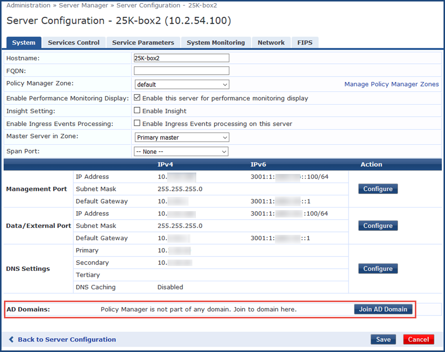

*Tab System, mục AD Domains chưa join (khung đỏ), nút Join AD Domain. Lưu ý DNS Primary phải là IP của domain controller.*

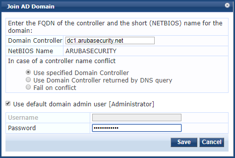

*Hộp thoại Join AD Domain: nhập FQDN, NetBIOS Name tự điền, nhập mật khẩu.*

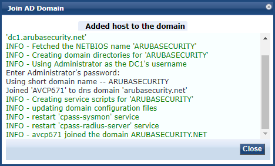

*Thông báo Added host to the domain. Dòng cuối của log báo server đã join domain.*

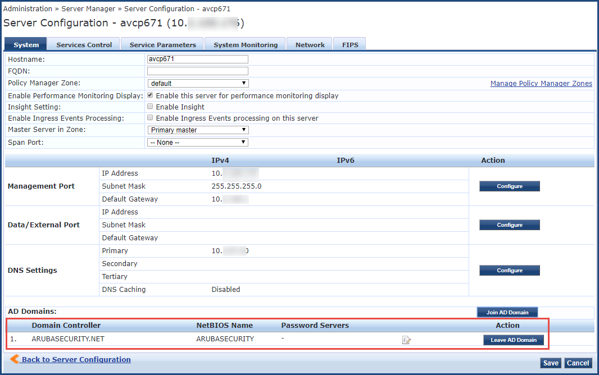

*Mục AD Domains liệt kê domain đã join, nút Leave AD Domain và biểu tượng Modify Password Servers.*

Hướng dẫn chi tiết từng tham số xem [Huong-dan-tich-hop-AD-vao-ClearPass.md](Huong-dan-tich-hop-AD-vao-ClearPass.md).


> Sau khi join, trong AD xuất hiện một **computer account** cho node ClearPass.

**Chỉ định danh sách DC dùng cho xác thực MSCHAPv2 (tùy chọn):**
**Server Configuration → chọn server → tab System → Modify Password Servers** → nhập tên các domain controller (mỗi dòng một DC) → **Save**. Nếu không khai báo, ClearPass dùng tất cả DC lấy được từ DNS.

**Kiểm tra xác thực với AD bằng CLI** (SSH vào ClearPass, đăng nhập `appadmin`):

```
ad auth -h
```

Dùng lệnh `ad auth` theo hướng dẫn hiển thị để thử một tài khoản domain. Kết quả thành công hiển thị **NT_STATUS_OK: Success (0x0)**.

> Cú pháp chính xác của `ad auth` kiểm tra bằng `ad auth -h` trên phiên bản ClearPass đang dùng.

Để rời domain (khi cần làm lại): **Server Configuration → chọn server → Leave AD Domain** → nhập mật khẩu quản trị → **Leave**.

### 6.4 Certificate cho RADIUS

Khi dùng PEAP, laptop cần **tin cậy certificate** của ClearPass để không hiện cảnh báo hoặc bị lỗi kết nối.

1. **Administration → Certificates → Certificate Store → Server Certificates → Create Certificate Signing Request** (dùng cho `RADIUS/EAP`).
2. Ký CSR bằng CA nội bộ, rồi nhập certificate đã ký (**Import Certificate**).
3. Ở **giai đoạn 4 (mục 9)**: đẩy **Root CA** vào **Trusted Root Certification Authorities** của laptop bằng GPO, và trong cấu hình PEAP trên laptop tick **"Verify the server's identity by validating the certificate"**, chọn Root CA đó.
4. Trong Service 802.1X (mục 8.5), chọn certificate này ở trường **Service Certificate** nếu cần.

> Làm bước này **trước** khi cấu hình laptop: GPO cần Root CA đã có.


---

## 7. Giai đoạn 2: Danh tính và dữ liệu trên ClearPass

> Ba mục này tạo dữ liệu mà giai đoạn 3 tham chiếu. Làm đủ cả ba trước khi sang giai đoạn 3.

### 7.1 Tạo Authentication Source: Active Directory

**Configuration → Authentication → Sources → Add**:

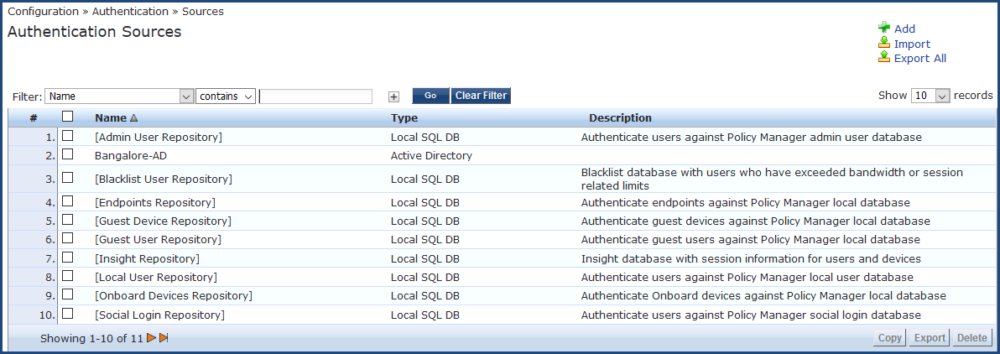

*Trang Authentication Sources. Bấm Add ở góc trên bên phải. Trong ví dụ có sẵn nguồn `Bangalore-AD` loại Active Directory.*

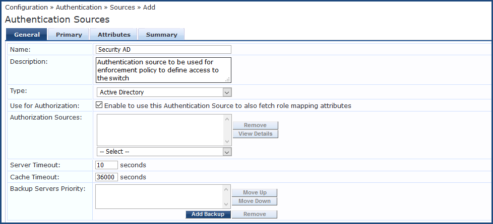

*Tab General: Name, Description, Type = Active Directory, Use for Authorization (mặc định bật), Server Timeout, Cache Timeout, Backup Servers Priority.*

| Trường | Giá trị |
|---|---|
| **Name** | `AD-Congty` (tùy đặt) |
| **Type** | Active Directory |
| **Use for Authorization** | Bật (để lấy group/thuộc tính) |

Tab **Primary**:

| Trường | Giá trị |
|---|---|
| **Hostname** | FQDN hoặc IP của DC |
| **Connection Security** | Chọn **AD over SSL** để dùng LDAPS (cổng tự điền **636**). Nếu dùng LDAP thường thì cổng **389**. Hãng cảnh báo: không dùng SSL thì tên và mật khẩu bind đi qua mạng dạng clear text. Khi dùng SSL phải thêm CA certificate của AD vào Certificate Trust List của ClearPass |
| **Port** | 389 (LDAP) hoặc 636 (LDAPS). Forest nhiều domain dùng Global Catalog: 3268 (không SSL), 3269 (có SSL) |
| **Verify Server Certificate** | Bật khi dùng kết nối bảo mật |
| **Bind DN** | Tài khoản service chỉ đọc. Ô nhập chấp nhận cả dạng UPN (ví dụ `svc-clearpass@congty.local`) và dạng DN (ví dụ `cn=svc-clearpass,cn=users,dc=congty,dc=local`) |
| **Bind Password** | Mật khẩu service account |
| **NetBIOS Domain Name** | `CONGTY` (có thể ClearPass tự điền) |
| **Base DN** | `DC=congty,DC=local` (hoặc OU cụ thể) |
| **Search Scope** | SubTree Search |


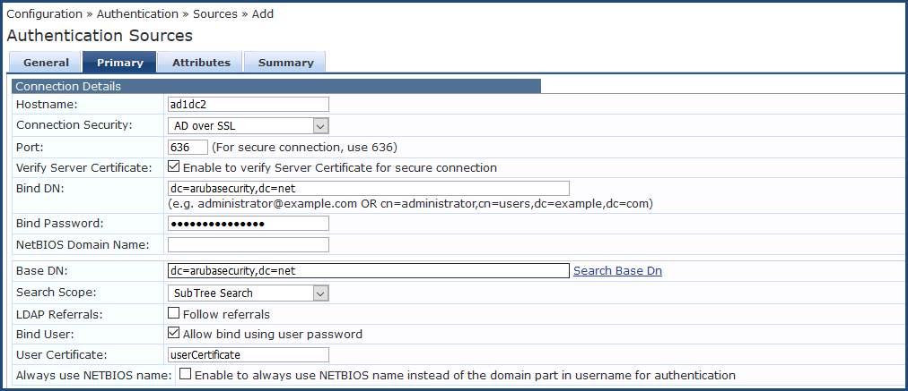

*Tab Primary: Hostname, Connection Security = AD over SSL, Port 636, Verify Server Certificate, Bind DN, Bind Password, Base DN, Search Scope, LDAP Referrals (không tick), User Certificate.*

Nhấp **Search Base Dn** để duyệt cây LDAP. Hãng cho biết đây cũng là cách thử kết nối tới AD: nếu duyệt được cây thư mục thì thông số primary đã đúng. Hãng khuyến nghị **thu hẹp Base DN** tới OU chứa user thay vì giữ giá trị tự điền, và **không tick Follow referrals**. Thêm DC dự phòng bằng nút **Add Backup** ở tab General (hãng khuyến nghị có ít nhất một backup).

Tab **Attributes** (lấy nhóm AD). Mặc định ClearPass đã có các filter **Authentication**, **Group**, **Machine** và hai filter Onboard:

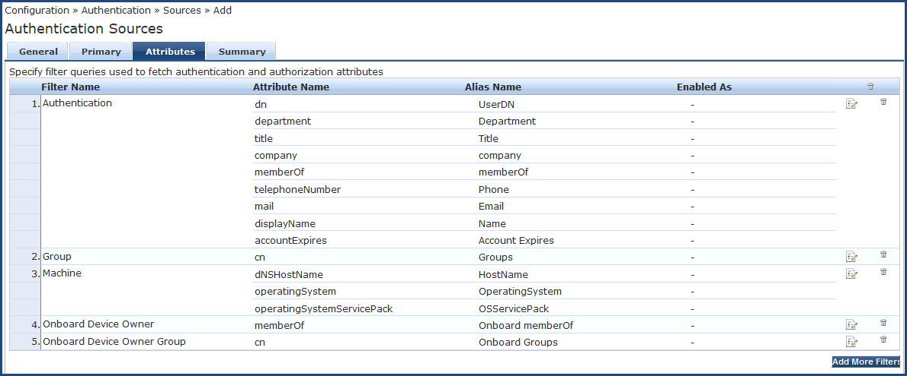

*Tab Attributes. Filter Authentication lấy `memberOf`, `mail`, `displayName`... Filter Group lấy `cn`. Filter Machine lấy `dNSHostName`, `operatingSystem`, `operatingSystemServicePack`.*


Theo ClearPass 6.12 User Guide, nếu **không dùng RADIUS** lấy group, dùng filter group `(distinguishedName=%{memberOf})`. Với xác thực RADIUS cần tra **nhóm lồng nhau (nested groups)**, thêm một filter như sau:

| Trường | Giá trị |
|---|---|
| **Filter Name** | `Nested Groups` (ví dụ) |
| **Filter Query** | `(&(objectClass=user)(sAMAccountName=%{Authentication:Username}))` |
| **Attribute Name** | `tokenGroups` |
| **Alias Name** | `Nested Groups` |

> Từ thảo luận Airheads: nếu một người thuộc nhiều AD group, so khớp `memberOf` có thể chỉ trả về một group. Nên dùng thuộc tính nested group ở trên hoặc dùng toán tử **MATCHES_ANY** khi tạo Role Mapping.

> Quan trọng: theo webinar HPE Aruba, với dịch vụ EAP-PEAP-MSCHAPv2, **bước xác thực (kiểm tra mật khẩu) tách biệt với Authentication Source AD**. Nguồn AD này trong trường hợp đó chủ yếu phục vụ **phân quyền (authorization)** (lấy group, thuộc tính).

### 7.2 Tạo whitelist MAC (Endpoints)

Mục tiêu: ClearPass biết MAC nào là **hợp lệ**. Có ba cách. **Lưu ý:** Một thảo luận Airheads cho biết **không thể import CSV trực tiếp vào Endpoints Repository** (cần dùng XML hoặc REST API).

**Mẫu CSV cung cấp bởi khách hàng:**

```
mac,hostname,user,department,note
aabbccddeeff,LT-KT-001,nguyenvana,Ke toan,Laptop Dell
112233445566,LT-IT-002,tranvanb,IT,Laptop HP
```

Định dạng MAC thống nhất: 12 ký tự hex, chữ thường, không dấu phân cách (ví dụ `aabbccddeeff`).

#### Cách A: Endpoints Repository (nhập tay, ít máy)

**Configuration → Identity → Endpoints → Add**:

- **MAC Address:** `aabbccddeeff`
- **Description:** tên máy/người dùng
- **Status:** `Known client` (hai lựa chọn còn lại là `Unknown client` và `Disabled client`; `Disabled client` dùng để chặn một MAC)

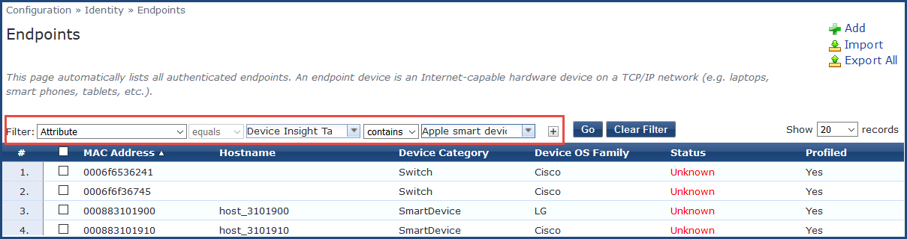

*Trang Endpoints (Configuration, Identity, Endpoints). Bấm Add ở góc trên bên phải. Ảnh minh họa bộ lọc theo thuộc tính.*

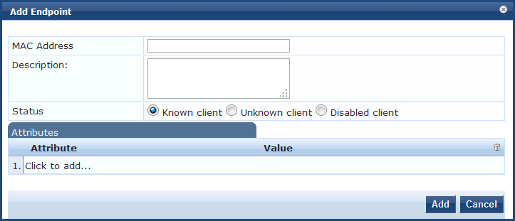

*Hộp thoại Add Endpoint: MAC Address, Description, Status (Known client, Unknown client, Disabled client), Attributes (thuộc tính tùy chỉnh).*

Thuộc tính tùy chỉnh (Attributes) là kiểu String, và mọi thuộc tính đã nhập đều dùng được trong Rules Editor của role mapping.


#### Cách B: Endpoints Repository qua REST API (nhiều máy)

1. Tạo API client: **Administration → API Services → API Clients → Add** (Operating Mode: ClearPass REST API, Grant Type: client credentials).
2. Lấy token (thay `<cppm-ip>`, `<client_id>`, `<client_secret>`):

```bash
curl -k -X POST https://<cppm-ip>/api/oauth \
  -H "Content-Type: application/json" \
  -d '{"grant_type":"client_credentials","client_id":"<client_id>","client_secret":"<client_secret>"}'
```

3. Tạo endpoint **Known** từ token nhận được (`<token>`):

```bash
curl -k -X POST https://<cppm-ip>/api/endpoint \
  -H "Authorization: Bearer <token>" \
  -H "Content-Type: application/json" \
  -d '{"mac_address":"aabbccddeeff","description":"LT-KT-001 nguyenvana","status":"Known"}'
```

4. Import hàng loạt từ file CSV ở trên (bash, bỏ dòng tiêu đề). Dòng nào đã tồn tại sẽ trả lỗi, cần dùng PATCH thay cho POST:

```bash
TOKEN="<token>"
CPPM="<cppm-ip>"
tail -n +2 danhsach-mac.csv | while IFS=, read -r mac host user dept note; do
  curl -k -s -X POST "https://$CPPM/api/endpoint" \
    -H "Authorization: Bearer $TOKEN" \
    -H "Content-Type: application/json" \
    -d "{\"mac_address\":\"$mac\",\"description\":\"$host $user\",\"status\":\"Known\"}"
  echo
done
```

> **⚠ Cần xác nhận:** tên trường JSON và đường dẫn API theo ClearPass Swagger của bản đang dùng: `https://<cppm-ip>/api-docs`. Thử trên 1–2 MAC trước khi chạy hàng loạt.

#### Cách C: ClearPass Guest, Manage Devices (import CSV trực tiếp)

Theo một thảo luận Airheads: đăng ký một thiết bị thủ công ở **Guest → Manage Devices**, **export CSV** để lấy đúng cột, rồi import file của bạn qua **Guest → Manage Devices → More Options**. Các cột gồm `username` (MAC viết hoa, có dấu gạch ngang), `sponsor_name`, `mac_auth` = `1`, `role_id`, `enabled` = `1`, `expire_time` (tùy chọn). Khi dùng cách này, **Authorization Source** của Service phải là **Guest Device Repository** thay vì Endpoints Repository, và điều kiện role mapping cũng khác. Chỉ chọn cách này nếu khách hàng muốn quản lý danh sách thiết bị bằng giao diện Guest.

> Trong phần còn lại của tài liệu dùng **Cách A/B (Endpoints Repository)**.

### 7.2.1 Thiết bị miễn trừ (whitelist ngoại lệ)

**Mục tiêu:** một số máy (máy lãnh đạo, máy test) **không bị áp dụng** chính sách domain và chính sách giờ. Chúng vào mạng theo MAC, bất kể giờ.

> **Cân nhắc bảo mật trước khi làm.** Xác thực chỉ bằng MAC có thể bị giả mạo (đổi MAC trên máy khác). Danh sách miễn trừ phải **ngắn, có người duyệt, có ngày hết hạn**, và nên rà soát định kỳ. Máy lãnh đạo là mục tiêu giá trị cao, nên cân nhắc cho dùng 802.1X bình thường và chỉ miễn trừ **chính sách giờ**.

**Có ba cách miễn trừ, chọn theo nhu cầu:**

| Cách | Máy có phải đăng nhập domain không | Giờ giấc | Ưu điểm | Nhược điểm |
|---|---|---|---|---|
| **A. Miễn trừ theo MAC trên ClearPass (khuyến nghị)** | **Không**. Máy vào bằng MAB (xác thực theo MAC) | **Không bị giới hạn giờ** | Một nơi quản lý. Máy cắm cổng nào cũng được. Có thể gắn lý do và ngày hết hạn | Cần MAB trên switch và service MAC Authentication (mục 8.6). MAC có thể bị giả mạo |
| **B. Miễn trừ theo cổng trên switch** | **Không** | **Không bị giới hạn giờ** | Đơn giản, không phụ thuộc ClearPass | **Bất kỳ thiết bị nào** cắm vào cổng đó đều vào mạng. Chỉ dùng cho cổng cố định trong phòng kiểm soát |
| **C. Chỉ miễn trừ giờ** | **Có** (vẫn 802.1X bình thường) | **Không bị giới hạn giờ** | An toàn nhất, máy vẫn phải đăng nhập domain | Máy vẫn cần tài khoản domain hợp lệ |

**Dự án chọn cách A**: máy miễn trừ vào bằng MAC (MAB), không đăng nhập domain, không bị giới hạn giờ. Cách B xem mục 10.6 nếu có cổng cố định cần miễn trừ.

**Các bước trên ClearPass (cách A):**

1. **Configuration → Identity → Endpoints → Add** (như mục 7.2), nhập MAC của máy miễn trừ.
2. **Status:** `Known client`.
3. **Attributes:** thêm thuộc tính tùy chỉnh `Exempt` với giá trị `true`. Thêm `Reason` (lý do), `Approved-By` (người duyệt) và `Expire` (ngày hết hạn) để dễ rà soát. Thuộc tính tùy chỉnh là kiểu String và dùng được trong Rules Editor của Role Mapping (theo tài liệu ClearPass 6.14).
4. Sau đó dùng role `Exempt-Device` (mục 8.1 và 8.2) và rule đầu tiên trong Enforcement Policy (mục 8.4) để cho phép các máy này.

> **Lưu ý:** ClearPass không tự xóa máy khi quá `Expire`. Đặt lịch rà soát và xóa tay máy hết hạn khỏi danh sách.

### 7.3 Khai báo Network Devices (switch / WLC / AP)

**Configuration → Network → Devices → Add**:

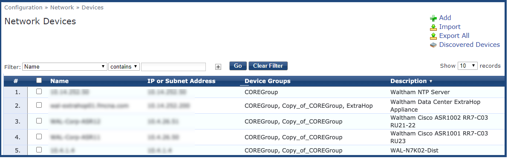

*Trang Network Devices. Bấm Add ở góc trên bên phải.*

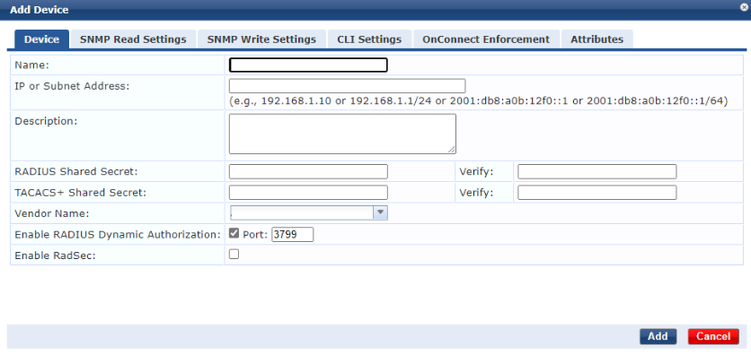

*Hộp thoại Add Device, tab Device: Name, IP or Subnet Address, RADIUS Shared Secret (nhập hai lần), Vendor Name, Enable RADIUS Dynamic Authorization (cổng 3799), Enable RadSec.*


| Trường | Giá trị |
|---|---|
| **Name** | `SW-ACCESS-01` |
| **IP or Subnet Address** | **IP nguồn mà switch dùng để gửi RADIUS** (nên cố định bằng source-interface) |
| **Vendor Name** | Chọn đúng hãng (Dell, Cisco). Nếu không có trong danh sách thì chọn mục chung và báo lại để kiểm tra |
| **RADIUS Shared Secret** | Chuỗi bí mật (phải **trùng** với cấu hình trên switch) |
| **Enable RADIUS Dynamic Authorization** | Bật, **Port** = `3799` (mặc định) cho switch **hỗ trợ CoA** (Dell N-Series, mục 10.3). Thiết bị phải nhận được cổng này từ ClearPass. **Cisco SG350: không bật** vì chưa thấy hỗ trợ CoA (mục 10.4) |
| **Enable RadSec** | Không tick (chỉ dùng khi switch hỗ trợ RadSec) |

Thiếu bước này, ClearPass bỏ qua yêu cầu từ switch (log "unknown NAS" trong Event Viewer).

---

## 8. Giai đoạn 3: Chính sách trên ClearPass

> Tạo **theo đúng thứ tự 8.1 đến 8.5**. Mỗi bước dùng kết quả của bước trước.

### 8.1 Tạo Roles

**Configuration → Identity → Roles → Add.** Role là nhãn mà Role Mapping gán cho yêu cầu, và Enforcement Policy dùng để quyết định cho vào hay chặn.

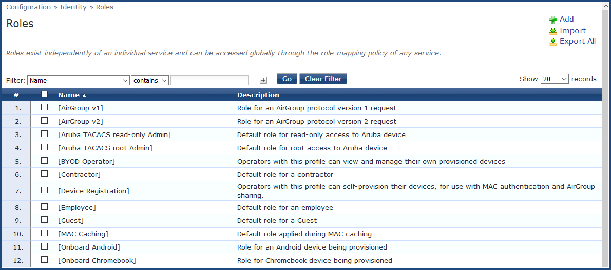

*Trang Roles. Bấm Add ở góc trên bên phải. Roles tồn tại độc lập với từng service.*

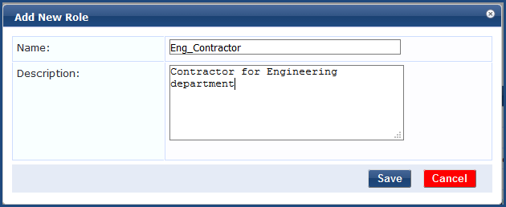

*Hộp thoại Add New Role: Name và Description.*

Tạo hai role:

| Name | Description |
|---|---|
| `Domain-User` | Tài khoản domain đúng (thuộc nhóm được phép) |
| `Allowed-Device` | MAC nằm trong whitelist |
| `Exempt-Device` | Máy miễn trừ (mục 7.2.1): không áp dụng chính sách domain và giờ |

### 8.2 Tạo Role Mapping

**Configuration → Identity → Role Mappings → Add.** Role Mapping gán role cho yêu cầu dựa trên thuộc tính lấy từ AD và Endpoints Repository. Tạo xong mới chọn được ở Service (mục 8.5).

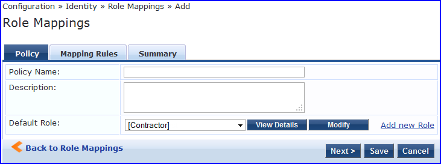

*Role Mappings, tab Policy: Policy Name, Description, Default Role.*

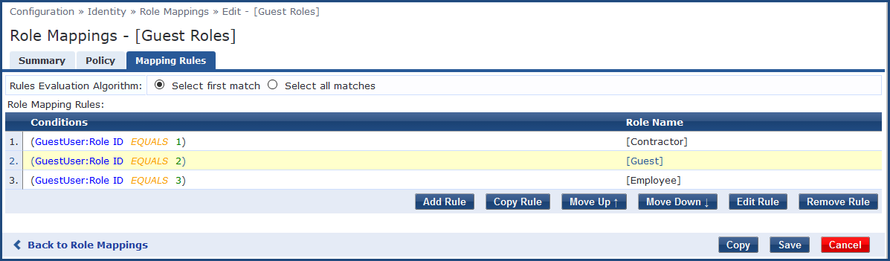

*Tab Mapping Rules: thuật toán Select first match, danh sách rule (điều kiện và Role Name), các nút Add Rule, Copy Rule, Move Up, Move Down, Edit Rule, Remove Rule.*

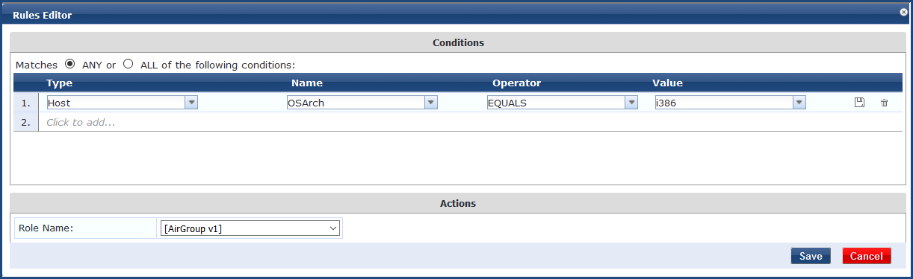

*Rules Editor: chọn Type, Name, Operator, Value và Role Name. Ảnh ví dụ dùng Type `Host`, Name `OSArch`.*


| Rule | Điều kiện | Role |
|---|---|---|
| 1 | `Authorization:AD-Congty:memberOf` **MATCHES_ANY** `CN=NAC-Allowed-Users,...` (hoặc `Authentication:Source EQUALS AD-Congty` nếu không dùng group) | `Domain-User` |
| 2 | `Authorization:[Endpoints Repository]:Status` **EQUALS** `Known` | `Allowed-Device` |
| 3 | `Authorization:[Endpoints Repository]:Exempt` **EQUALS** `true` | `Exempt-Device` |

> Tên thuộc tính `Exempt` trong rule 3 phải trùng thuộc tính đã nhập ở mục 7.2.1. **Cần thử trên ClearPass thực tế** cách thuộc tính tùy chỉnh của Endpoint hiện ra trong danh sách Name của Rules Editor.

Default Role: `[Other]`.

> Theo thảo luận Airheads, thuộc tính `Authorization:[Endpoints Repository]:Status` dùng được trong role mapping (đã được xác nhận với giá trị `Disabled`; `Known` dùng tương tự). Một số người dùng khuyên không lạm dụng `Known` làm điều kiện chung cho nhiều chính sách khác nhau. Trong bài toán này nó chỉ dùng để phân biệt MAC được cấp phép nên phù hợp.

### 8.3 Tạo Enforcement Profile

**Configuration → Enforcement → Profiles → Add.** Các profile hệ thống có sẵn như `[Allow Access Profile]` (RADIUS, cho phép truy cập mạng) và `[Deny Access Profile]`:

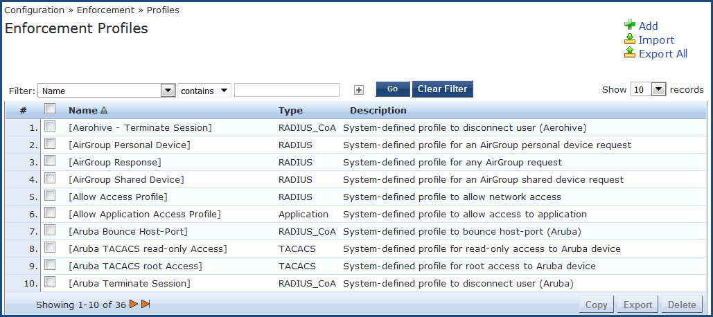

*Trang Enforcement Profiles với các profile hệ thống, ví dụ `[Allow Access Profile]`.*

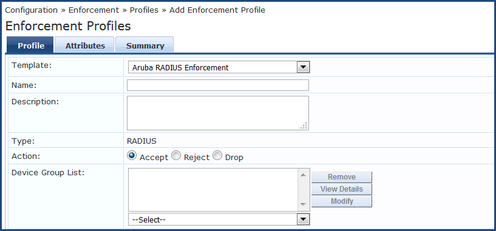

*Hộp thoại Add Enforcement Profile: Template, Name, Type = RADIUS, Action (Accept, Reject, Drop), Device Group List.*


- Với yêu cầu này **dùng luôn hai profile hệ thống có sẵn**, không cần tạo mới: `[Allow Access Profile]` (cho vào) và `[Deny Access Profile]` (chặn, trả **Access-Reject**).
- Chỉ tạo profile mới khi cần gán VLAN: chọn Template **Aruba RADIUS Enforcement** (mặc định trong ảnh), **Action = Accept**, thêm thuộc tính `Tunnel-Type = VLAN (13)`, `Tunnel-Medium-Type = 802 (6)`, `Tunnel-Private-Group-Id = <VLAN-ID>`.

> Với yêu cầu chỉ cần **cho vào / không cho vào**, bạn **không cần** gán VLAN; chỉ cần Accept hoặc Reject. Gán VLAN/role phụ thuộc hãng switch (Aruba CX dùng `Aruba-User-Role` hoặc thuộc tính VLAN tùy firmware), nên chỉ làm khi khách hàng yêu cầu.

### 8.4 Tạo Enforcement Policy

**Configuration → Enforcement → Policies → Add.** Mỗi service chỉ gắn **một** enforcement policy. Policy dùng các role (mục 8.2) và profile (mục 8.3) đã tạo ở trên:

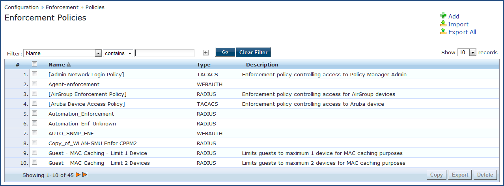

*Trang Enforcement Policies. Bấm Add ở góc trên bên phải.*

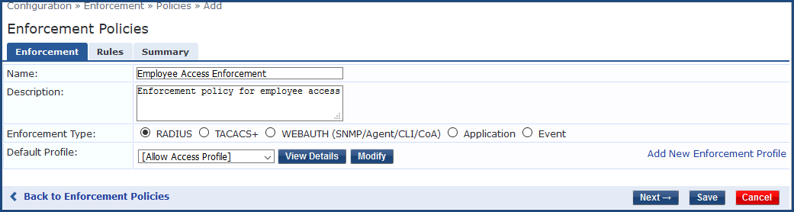

*Tab Enforcement: Name, Description, Enforcement Type = RADIUS, Default Profile (profile áp dụng khi không rule nào khớp), liên kết Add New Enforcement Profile.*

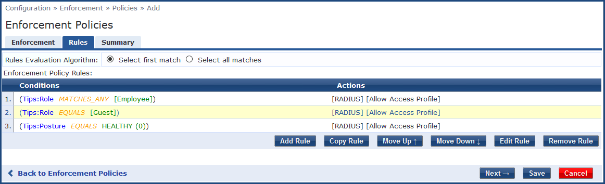

*Tab Rules: thuật toán Select first match, danh sách điều kiện (Tips:Role, Tips:Posture) và Actions, các nút Add Rule, Move Up, Move Down.*


| Rule | Điều kiện | Enforcement Profile |
|---|---|---|
| 1 | `Tips:Role` **MATCHES_ANY** `Exempt-Device` | `[Allow Access Profile]` |
| 2 | `Tips:Role` **MATCHES_ALL** `Domain-User` `Allowed-Device` **và** `Date:Time-of-Day` **IN_RANGE** `04:00` đến `21:00` | `[Allow Access Profile]` |
| Default | (không khớp) | `[Deny Access Profile]` |

Trong tab **Enforcement** của policy, đặt **Default Profile** = `[Deny Access Profile]` để mọi trường hợp không khớp đều bị chặn.

#### Chính sách giờ (chặn từ 21:00 đến 04:00 sáng)

**Khung giờ của dự án:** chặn từ **21:00 đến 04:00 sáng hôm sau**, mọi ngày. Khung chặn này **đi qua nửa đêm** (00:00). Vì `IN_RANGE` so sánh giá trị đầu nhỏ hơn giá trị sau trong cùng một ngày, **không khai báo khung chặn trực tiếp**. Thay vào đó khai báo **khung cho phép** `04:00 đến 21:00` (không qua nửa đêm). Mọi giờ còn lại (21:00 đến 04:00) rơi xuống Default và bị chặn.

**Ranh giới:** theo tài liệu `IN_RANGE` đúng khi giá trị lớn hơn hoặc bằng giá trị thứ nhất và nhỏ hơn hoặc bằng giá trị thứ hai. Vì vậy lúc đúng 21:00 vẫn được cho vào, và quá 21:00 mới bị chặn. Nếu muốn chặn từ đúng 21:00, nhập giá trị kết thúc `20:59`. Cần thử trên ClearPass để xem ô giờ nhận độ chính xác đến phút hay giây.

**Cách hoạt động.** Policy dùng thuật toán **Select first match**: rule nào khớp trước thì áp dụng và dừng. Vì vậy **thứ tự rule rất quan trọng**:

1. Rule 1 (miễn trừ) đứng **trên cùng**: máy miễn trừ được vào bất kể giờ.
2. Rule 2 (người dùng thường) chỉ cho vào **trong khung giờ**. Ngoài khung giờ rule 2 không khớp, yêu cầu rơi xuống **Default** và bị chặn.

**Cách tạo điều kiện giờ trong Rules Editor** (theo tài liệu ClearPass 6.14):

1. Ở tab **Rules** của policy, bấm **Add Rule** (hoặc **Edit Rule** cho rule 2).
2. Thêm điều kiện thứ nhất: `Tips:Role` **MATCHES_ALL** `Domain-User`, `Allowed-Device`.
3. Thêm điều kiện thứ hai: **Type** = `Date`, **Name** = `Time-of-Day`, **Operator** = `IN_RANGE`. Ô giá trị có biểu tượng giờ: nhập giờ bắt đầu `04:00` và giờ kết thúc `21:00`.
4. Chọn kiểu khớp **Matches ALL of the following conditions** (cả hai điều kiện phải đúng).
5. **Actions:** `[Allow Access Profile]`.
6. Dùng **Move Up**/**Move Down** để rule 1 (miễn trừ) nằm trên rule 2.

**Theo tài liệu**, namespace **Date** có ba thuộc tính: `Day-of-Week`, `Date-of-Year`, `Time-of-Day`, và dùng được trong Enforcement Policy. Toán tử `IN_RANGE` áp dụng cho kiểu giờ và ngày: đúng khi giá trị lúc chạy lớn hơn hoặc bằng giá trị thứ nhất và nhỏ hơn hoặc bằng giá trị thứ hai.

**Thêm điều kiện theo ngày trong tuần** (ví dụ chỉ thứ hai đến thứ bảy): thêm điều kiện `Date` / `Day-of-Week` / **BELONGS_TO** `MONDAY,TUESDAY,WEDNESDAY,THURSDAY,FRIDAY,SATURDAY`.

**Ba điều cần lưu ý:**

| Vấn đề | Cách xử lý |
|---|---|
| **Múi giờ.** Tài liệu không nêu rõ `Time-of-Day` dùng múi giờ nào | Đặt đúng múi giờ ở mục 6.2 (`Asia/Ho_Chi_Minh`). **Cần thử** bằng cách tạm đặt khung giờ quanh giờ hiện tại để xác nhận ClearPass tính đúng |
| **Phiên đang kết nối lúc 21:00 không bị ngắt ngay.** Chính sách chỉ được đánh giá lúc xác thực | Switch xác thực lại theo chu kỳ: Dell `dot1x timeout re-authperiod <giây>` và Cisco SG350 `dot1x timeout reauth-period <giây>` (mặc định 3600 giây, tối thiểu 300). Đặt chu kỳ ngắn (ví dụ 1800 giây) để máy bị cắt sau tối đa khoảng đó kể từ 21:00. Chu kỳ ngắn làm tăng tải RADIUS. Xem mục 10.3 và 10.4 |
| **Cắt ngay đúng 21:00** | Cần ClearPass gửi CoA hoặc Disconnect theo lịch. Tài liệu đã đọc **không** mô tả cách lập lịch việc này. Hãy xác nhận với HPE hoặc thử trên lab trước khi hứa với khách hàng |

> **Lưu ý SG350:** `dot1x timeout reauth-period` chỉ áp dụng cho phương thức 802.1X, không áp dụng cho MAC-based. Máy vào bằng MAB trên SG350 không bị xác thực lại theo chu kỳ.

### 8.5 Tạo Service 802.1X Wired (bước cuối của giai đoạn 3)

**Configuration → Services → Add.** Chọn template **802.1X Wired** (mạng dây) hoặc **802.1X Wireless** (Wi-Fi). Bước này dùng các thành phần đã tạo ở mục 7.1 (Authentication Source), 8.2 (Role Mapping), 8.4 (Enforcement Policy).

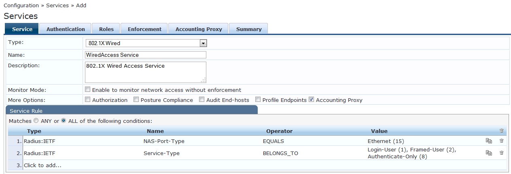

*Tab Service của template 802.1X Wired: Name, Description, Monitor Mode, More Options, Service Rule (`Radius:IETF NAS-Port-Type EQUALS Ethernet (15)` và `Service-Type BELONGS_TO Login-User, Framed-User, Authenticate-Only`). Các tab: Service, Authentication, Roles, Enforcement, Accounting Proxy, Summary.*

**Tab Service:**

| Trường | Giá trị |
|---|---|
| **Name** | `802.1X-Domain-MAC` |
| **Monitor Mode** | **Tick trong giai đoạn pilot** (chỉ giám sát, không chặn thật). Bỏ tick ở mục 12.1 |
| **More Options** | Tick **Authorization** để hiện tab Authorization |
| **Service Rule** | Mặc định của template. Có thể thêm điều kiện theo **Device Group** để chỉ áp dụng cho switch pilot |

**Tab Authentication:**

| Trường | Giá trị |
|---|---|
| **Authentication Methods** | `[EAP PEAP]` đặt đầu danh sách (ClearPass đề xuất phương thức đầu tiên). Chỉ giữ phương thức bạn dùng |
| **Authentication Sources** | `AD-Congty` (tạo ở mục 7.1) |
| **Strip Username Rules** | Tick nếu cần bỏ tiền tố hoặc hậu tố tên đăng nhập |
| **Service Certificate** | Chọn certificate ở mục 6.4 nếu cần |

**Tab Authorization (rất quan trọng):**

- **Additional authorization sources:** thêm **`AD-Congty`** và **`[Endpoints Repository]`**.

> **Cảnh báo (từ thảo luận Airheads):** `[Endpoints Repository]` phải nằm ở **tab Authorization**, **không phải tab Authentication**. Cấu hình sai chỗ làm dịch vụ MAC auth chạy được nhưng 802.1X lỗi.

**Tab Roles:** chọn **Role Mapping Policy** đã tạo ở mục 8.2.

**Tab Enforcement:** chọn **Enforcement Policy** đã tạo ở mục 8.4. Trường này **bắt buộc**. Tùy chọn **Use Cached Results** dùng lại role và posture từ phiên trước.

**Tab Summary:** kiểm tra rồi **Save**.

### 8.6 Service MAC Authentication (MAB) cho thiết bị miễn trừ và thiết bị không có 802.1X

**Khi nào cần:** (1) thiết bị **miễn trừ theo cách A** (mục 7.2.1) không đăng nhập domain, (2) máy in, camera, IP phone không có supplicant 802.1X.

Theo tài liệu ClearPass 6.14, service **MAC Authentication** dùng cho client **không có 802.1X supplicant**: switch gửi yêu cầu xác thực theo MAC, ClearPass tra client trong danh sách cho phép hoặc danh sách chặn và có thể kiểm tra với nguồn bên ngoài. Loại service này **không cấu hình được posture**.

**Cấu hình** (**Configuration → Services → Add**, Type = `MAC Authentication`, các tab còn lại tương tự service 802.1X Wireless theo tài liệu):

| Tab | Giá trị |
|---|---|
| **Service** | Name `MAB-Domain-MAC`. Bật **Monitor Mode** trong giai đoạn pilot |
| **Authentication** | **Authentication Sources**: `[Endpoints Repository]`. Dùng danh sách Endpoint đã tạo ở mục 7.2 |
| **Authorization** (More Options) | Thêm `[Endpoints Repository]` để lấy thuộc tính `Exempt` |
| **Roles** | Chọn **cùng Role Mapping** ở mục 8.2 (rule 3 gán `Exempt-Device`) |
| **Enforcement** | Chọn Enforcement Policy. Có thể **dùng chung** policy ở mục 8.4: rule 1 cho `Exempt-Device` vào, các máy khác rơi xuống Default và bị chặn |

**Thứ tự Service** (mục 8.7): đặt `MAB-Domain-MAC` **dưới** service 802.1X. Hai service phân biệt nhau nhờ Service Rule (MAC Authentication dùng yêu cầu MAC-based của switch).

> Một thảo luận Airheads cho biết thiết bị không thuộc AD sẽ báo "not a member of AD" ở service 802.1X nếu không có service MAB đi kèm.

**Máy in, camera, IP phone** (thiết bị không miễn trừ nhưng không có 802.1X): thêm role riêng (ví dụ `MAB-Device`), một rule gán role đó cho Endpoint có `Status = Known client` và thuộc tính `Type` tương ứng, và một rule trong Enforcement Policy cho phép role này. Làm sau khi phần miễn trừ chạy ổn.

**Cấu hình MAB trên switch:** mục 10.3 (Dell) và 10.4 (Cisco SG350). **Quan trọng:** Dell gửi MAC dạng **chữ hoa, không dấu phân cách** (`XXXXXXXXXXXX`) làm tên đăng nhập, nên khi nhập Endpoint ở mục 7.2 dùng cùng dạng, hoặc kiểm tra ClearPass có so khớp không phân biệt hoa thường qua Access Tracker.

### 8.7 Thứ tự Service và kiểm tra ClearPass trước khi sang giai đoạn 4

1. Vào **Configuration → Services**, kéo Service `802.1X-Domain-MAC` **lên trên các service mặc định** để không bị service khác khớp trước.
2. Kiểm tra lại danh sách đã làm đủ ở giai đoạn 1 đến 3:
   - [ ] ClearPass đã join domain và hiện trong mục AD Domains (mục 6.3).
   - [ ] Authentication Source AD duyệt được cây LDAP bằng **Search Base Dn** (mục 7.1).
   - [ ] Ít nhất một MAC thử nghiệm ở trạng thái **Known client** (mục 7.2).
   - [ ] Network Device của switch pilot đã có, secret đã ghi lại (mục 7.3).
   - [ ] Nếu dùng thiết bị miễn trừ: Endpoint có `Exempt = true` (mục 7.2.1), role `Exempt-Device`, service MAC Authentication (mục 8.6).
   - [ ] Enforcement Policy: rule miễn trừ nằm **trên** rule giờ (mục 8.4).
   - [ ] Service 802.1X có **Monitor Mode** bật, Authentication, Authorization (AD và Endpoints Repository), Roles, Enforcement đã chọn đủ (mục 8.5).
3. Chuyển sang giai đoạn 4 (laptop), rồi giai đoạn 5 (switch).

---

## 9. Giai đoạn 4: Cấu hình laptop Windows

> **Làm trước khi bật 802.1X trên switch.** Nếu switch bật 802.1X trước khi laptop có cấu hình, laptop sẽ bị chặn. Cần Root CA từ mục 6.4. Với xác thực máy (computer account) hoặc EAP-TLS, xem giới hạn ở mục 1.

### 9.1 Bật dịch vụ Wired AutoConfig (mạng dây)

Mở PowerShell hoặc CMD **với quyền Administrator**:

```
sc config dot1x start= auto
net start dot1x
```

### 9.2 Cấu hình bằng GPO (khuyến nghị)

Theo tài liệu Microsoft về cấu hình 802.1X cho client có dây bằng Group Policy:

1. Mở **Group Policy Management**, tạo hoặc sửa GPO áp dụng cho OU chứa laptop.
2. **Computer Configuration → Policies → Windows Settings → Security Settings → Wired Network (IEEE 802.3) Policies** (mạng dây) hoặc **Wireless Network (IEEE 802.11) Policies** (Wi-Fi) → **Create A New Policy**.
3. Bật **Use Windows Wired AutoConfig service for clients**.
4. Tab **Security**:
   - **Enable use of IEEE 802.1X authentication**: bật.
   - **Select a network authentication method**: **Microsoft: Protected EAP (PEAP)** → **Properties**.
   - Tick **Verify the server's identity by validating the certificate** và chọn Root CA ở mục 6.4.
   - **Authentication method:** **Secured password (EAP-MSCHAP v2)** → **Configure** → tick **Automatically use my Windows logon name and password (and domain if any)** (theo Microsoft, tùy chọn này chỉ khả dụng khi chọn MS-CHAP v2).
   - **Authentication Mode:** **User or computer authentication** (hoặc **User authentication**).
5. Áp dụng GPO: trên laptop chạy `gpupdate /force` rồi khởi động lại.

### 9.3 Cấu hình tay (chỉ để thử nghiệm)

**Control Panel → Network and Sharing Center → Change adapter settings → chuột phải adapter Ethernet → Properties → tab Authentication**:

- Tick **Enable IEEE 802.1X authentication**.
- Chọn **Microsoft: Protected EAP (PEAP)** → **Settings** → chọn **Secured password (EAP-MSCHAP v2)** → **Configure** → tick **Automatically use my Windows logon name and password (and domain if any)**.

Kiểm tra trạng thái:

```
netsh lan show interfaces
netsh lan show profiles
```

### 9.4 Tắt MAC ngẫu nhiên (Wi-Fi)

**Settings → Network & Internet → Wi-Fi → [SSID] → Random hardware addresses → Off**. Nếu MAC thay đổi liên tục, whitelist sẽ không khớp.


---

## 10. Giai đoạn 5: Cấu hình switch

> **Chỉ làm giai đoạn này khi** giai đoạn 1 đến 4 đã xong: ClearPass đã có Network Device của switch (mục 7.3), Service đang ở **Monitor Mode** (mục 8.5) và laptop pilot đã nhận cấu hình 802.1X từ GPO (mục 9). Nếu switch bật 802.1X khi laptop chưa có cấu hình, laptop sẽ bị chặn.

### 10.1 Nguyên tắc an toàn (đọc trước khi gõ lệnh)

1. **Luôn có đường vào dự phòng:** console hoặc cổng quản trị ngoài luồng. Làm trong giờ bảo trì đã thống nhất.
2. **Chỉ bật 802.1X trên cổng access** nối laptop. **Không** bật trên cổng uplink, cổng quản trị và cổng nối tới ClearPass.
3. **Mặc định khác nhau giữa các hãng, và đây là điểm dễ gây mất kết nối:**
   - **Dell N-Series:** chế độ mặc định của cổng là `auto` (theo tài liệu Dell). Khi bật `dot1x system-auth-control` toàn cục, **mọi cổng chưa chỉnh sẽ đòi 802.1X**, kể cả uplink. Vì vậy **phải đặt cổng uplink về `force-authorized` trước khi bật 802.1X toàn cục**.
   - **Cisco SG350:** chế độ mặc định của cổng là `force-authorized` (theo tài liệu Cisco), nên cổng chưa cấu hình không bị ảnh hưởng.
4. **Không dùng phương thức `none`.** Theo tài liệu, Dell `aaa authentication dot1x default none` luôn cho phép truy cập. Cisco `aaa authentication dot1x default radius none` cho phép truy cập khi RADIUS không trả lời. Chỉ dùng `radius`.
5. **Secret** phải trùng với **RADIUS Shared Secret** trong Network Device (mục 7.3). **IP nguồn** của gói RADIUS phải trùng **IP Address** khai báo trong Network Device (đặt cố định bằng `source-interface`).
6. **Thứ tự lệnh trên mỗi switch:** (1) khai báo RADIUS, (2) bảo vệ cổng uplink, (3) AAA, (4) cấu hình cổng pilot, (5) **bật 802.1X toàn cục sau cùng**, (6) kiểm tra, (7) lưu cấu hình.
7. Làm **một switch pilot** trước, bắt đầu với **một cổng**.

### 10.2 Phân loại thiết bị theo danh sách `SW-Wireless.xlsx`

| Thiết bị | Model | Làm gì ở giai đoạn này | Mục |
|---|---|---|---|
| A2-SW-ACC-B_Srv, A2-SW-ACC02-B_Srv, A2-SW-ACC-A307 | Dell N3224T-ON | Switch access: cấu hình theo Dell N-Series | 10.3 |
| A2-SW-A-TRET, A2-SW-ACC-A-LAU1, A2-SW-ACC-A-LAU2 | Dell PowerConnect N2024 | Switch access: cấu hình theo Dell N-Series | 10.3 |
| A2-SW-A-LAU2-Cisco | Cisco SG350-52 | Switch access: cấu hình theo Cisco SG350 | 10.4 |
| A2-SW-Core | Dell PowerConnect N4032 | Switch core: **không bật 802.1X**, chỉ bảo đảm định tuyến VLAN và cho phép UDP 1812/1813, 3799 | 10.5 |
| A2-SW-Core-02, A2-SW-Core-03 | Dell EMC S4112F-ON, S4148F-ON | Switch core: **không bật 802.1X** | 10.5 |
| WLC9800-Cisco | Cisco 9800-L | Wi-Fi, làm ở giai đoạn sau | 10.5 |

### 10.3 Dell N-Series (N2024, N3224T-ON)

**Nguồn:** *Dell EMC Networking N-Series CLI Reference Guide* (bản 6.3.x, tải từ `dl.dell.com`). Cú pháp dưới đây đã được đối chiếu từng lệnh với tài liệu này.

> **Cần kiểm tra trước khi áp dụng:**
> - Tài liệu Dell nêu trên liệt kê các dòng N1100-ON, N1500, N2000, N2100-ON, N3000, N3100-ON, N4000. **N3224T-ON thuộc dòng N3200-ON, không nằm trong danh sách đó.** Hãy chạy `show version` để xem firmware thực tế và đối chiếu với CLI Guide đúng phiên bản trên trang hỗ trợ của Dell.
> - Một thảo luận trên cộng đồng Dell (N2048P, firmware mới) dùng thêm các lệnh `authentication port-control auto` và `authentication enable`. Bản 6.3 trong tài liệu trên **không có** lệnh `authentication port-control`. Nếu lệnh dưới đây báo lỗi, đối chiếu với CLI Guide của firmware bạn đang dùng.
> - Trong tài liệu, mỗi cổng và cổng uplink được viết kiểu `gi1/0/1`, `Te1/0/49`. Đổi tên cổng cho đúng switch thực tế (`show interfaces status`).

**Bước 1: Khai báo RADIUS server (ClearPass).** Thay `<...>` bằng giá trị thật:

```
configure
radius-server host auth <IP-ClearPass>
 key "<SHARED-SECRET>"
 usage dot1x
 primary
 exit
radius-server host acct <IP-ClearPass>
 key "<SHARED-SECRET>"
 exit
radius-server source-interface vlan <VLAN-quan-tri>
```

- `radius-server host` vào chế độ cấu hình RADIUS server. `auth` là máy chủ xác thực (cổng mặc định **1812**), `acct` là kế toán (cổng mặc định **1813**).
- `usage dot1x` giới hạn máy chủ này cho 802.1X. Giá trị hợp lệ: `login`, `dot1x`, `all` (mặc định `all`).
- `radius-server source-interface vlan <id>` đặt IP nguồn của gói RADIUS. Mặc định là IP của VLAN gửi gói hoặc IP cổng out-of-band. IP nguồn phải khớp **IP Address** của Network Device trong ClearPass.

**Bước 2: Bảo vệ cổng uplink và cổng quản trị** (làm **trước** khi bật 802.1X toàn cục):

```
interface range Te1/0/49-50
 dot1x port-control force-authorized
 exit
```

`force-authorized` tắt 802.1X trên cổng và cho cổng chuyển ngay sang trạng thái authorized mà không cần xác thực. Lặp lại cho **mọi cổng không phải cổng laptop**: uplink, cổng nối server, cổng quản trị, cổng nối ClearPass.

**Bước 3: AAA cho 802.1X:**

```
aaa authentication dot1x default radius
```

**Bước 4: Cổng CoA (nếu dùng).** Cho phép ClearPass gửi CoA hoặc Disconnect tới switch (khớp tùy chọn **Enable RADIUS Dynamic Authorization**, cổng 3799 ở mục 7.3):

```
aaa server radius dynamic-author
 client <IP-ClearPass> server-key 0 "<SHARED-SECRET>"
 port 3799
 auth-type any
 exit
```

Tài liệu Dell cho biết khi cấu hình mục này, switch bắt đầu lắng nghe cổng 3799 và nhận CoA từ `client` đã khai báo. IP `client` phải là IP mà ClearPass dùng để gửi CoA.

**Bước 5: Cấu hình cổng laptop pilot** (ví dụ cổng `gi1/0/10`):

```
interface gi1/0/10
 dot1x port-control auto
 dot1x reauthentication
 exit
```

- `dot1x port-control auto` bật 802.1X trên cổng. Cổng chuyển sang authorized hoặc unauthorized tùy kết quả xác thực.
- `dot1x reauthentication` bật xác thực lại định kỳ (mặc định tắt). Khoảng thời gian chỉnh bằng `dot1x timeout re-authperiod`.
- Mỗi cổng laptop chỉ có một máy, nên dùng `auto`. Chế độ `mac-based` (nhiều host trên một cổng) yêu cầu cổng ở chế độ `switchport general`, chỉ dùng khi có IP phone nối tiếp laptop.
- Tài liệu Dell khuyến nghị tắt spanning tree hoặc bật PortFast trên cổng edge để cổng chuyển nhanh sang forwarding sau khi xác thực. Kiểm tra lệnh PortFast đúng với firmware.

**Bước 6: Bật 802.1X toàn cục. Lần đầu dùng chế độ giám sát (monitor).**

```
dot1x system-auth-control monitor
```

Theo tài liệu Dell: chế độ monitor **luôn cho phép truy cập mạng, kể cả khi xác thực thất bại**, nhưng vẫn gửi yêu cầu xác thực để bạn xem log trên ClearPass. Dùng ở giai đoạn pilot (mục 11).

**Bước 7: Chuyển sang chặn thật (làm ở mục 12):**

```
no dot1x system-auth-control monitor
dot1x system-auth-control
```

**Bước 8: Kiểm tra và lưu:**

```
show dot1x
show dot1x interface gi1/0/10
show dot1x clients all
show dot1x users
show aaa servers
end
write
```

- `show dot1x` hiển thị trạng thái 802.1X toàn cục, kể cả **Monitor Mode** đang bật hay tắt.
- `show dot1x clients all` và `show dot1x users` cho thấy client và user đã xác thực.
- `show aaa servers` liệt kê các RADIUS server đã cấu hình.
- `write` tương đương `copy running-config startup-config`.

**Cổng cho thiết bị không có 802.1X (máy in, camera, IP phone), dùng MAB:**

```
authentication enable
interface gi1/0/20
 dot1x port-control mac-based
 dot1x mac-auth-bypass
 authentication order dot1x mab
 exit
```

- `dot1x mac-auth-bypass` bật MAB (mặc định tắt). Theo tài liệu, với MAB, tên người dùng và mật khẩu gửi lên là MAC của thiết bị dạng `XXXXXXXXXXXX` (12 ký tự hex **chữ hoa**, không dấu phân cách).
- Theo tài liệu, xác thực bằng MAB **chỉ xảy ra sau khi hết thời gian `dot1x timeout guest-vlan-period`**.
- `mac-based` yêu cầu cổng ở chế độ `switchport general`.
- `authentication priority` trong bản 6.3 là lệnh không có tác dụng (chỉ giữ để tương thích).
- Service MAB tương ứng trong ClearPass: mục 8.6.

**Nếu cần RADIUS gán VLAN** (không bắt buộc cho yêu cầu cho vào hoặc chặn): thêm `aaa authorization network default radius` ở chế độ cấu hình toàn cục. Theo tài liệu, lệnh này bật VLAN do RADIUS gán.

### 10.4 Cisco SG350-52

**Nguồn:** *Cisco Business 350 Series CLI Guide* (các mục *802.1X Commands* và *RADIUS Commands*) và bài *Configure Global 802.1x Properties on a Switch through the CLI* (SMB5635, dòng Sx350). Cú pháp dưới đây đã được đối chiếu từng lệnh với các tài liệu này.

> **Cần kiểm tra trước khi áp dụng:**
> - CLI Guide ở trên là của dòng **Cisco Business 350**, gần giống nhưng không hoàn toàn trùng với **SG350**. Chạy `show version` và đối chiếu với CLI Guide của SG350 theo firmware.
> - Tên cổng trong tài liệu là `gi1/0/1`. Kiểm tra `show interfaces status` để biết tên thật trên SG350-52.
> - **Không tìm thấy** hỗ trợ **CoA / RADIUS Dynamic Authorization** trong CLI Guide đã đọc. Hãy coi SG350 như **không hỗ trợ CoA** cho tới khi kiểm chứng. Hệ quả: thay đổi whitelist chỉ có hiệu lực ở lần **xác thực lại** (dùng `dot1x reauthentication`, bước 5). Trong Network Device của ClearPass **không bật** Dynamic Authorization cho switch này.

**Bước 1: Khai báo RADIUS server (ClearPass):**

```
configure
radius-server host <IP-ClearPass> auth-port 1812 acct-port 1813 key <SHARED-SECRET> usage dot1.x
radius-server host source-interface vlan <VLAN-quan-tri>
```

- `usage dot1.x` giới hạn máy chủ cho xác thực cổng 802.1X. Giá trị hợp lệ: `login`, `dot1.x`, `all` (mặc định `all`). Chú ý có dấu chấm trong `dot1.x`.
- `acct-port` mặc định 1813. Đặt `0` để không dùng cho kế toán.
- Lệnh `radius-server host source-interface <interface-id>` đặt IP nguồn của gói RADIUS. Kiểm tra cú pháp `interface-id` (ví dụ `vlan 10`) bằng `?` trên switch.

**Bước 2: AAA cho 802.1X:**

```
aaa authentication dot1x default radius
```

Chỉ dùng `radius`. Không dùng `radius none` hoặc `none` (mục 10.1).

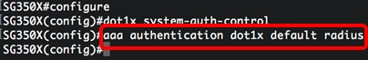

*Ảnh từ bài SMB5635 của Cisco: lệnh `aaa authentication dot1x default radius`.*

**Bước 3: Cổng uplink và cổng quản trị:** mặc định đã là `force-authorized` nên không cần làm gì. Nếu từng chỉnh, đặt lại:

```
interface gi1/0/49
 dot1x port-control force-authorized
 exit
```

**Bước 4: Cấu hình cổng laptop pilot** (ví dụ `gi1/0/10`):

```
interface gi1/0/10
 dot1x port-control auto
 dot1x host-mode multi-sessions
 dot1x reauthentication
 exit
```

- `dot1x port-control auto` bật 802.1X. Theo tài liệu: khi chưa xác thực xong, mọi lưu lượng vào ra cổng bị chặn.
- `dot1x host-mode`: mặc định là `multi-host`. Với một laptop mỗi cổng, có thể giữ mặc định. `multi-sessions` xác thực từng thiết bị riêng, dùng khi có nhiều thiết bị trên cổng.
- `dot1x reauthentication` bật xác thực lại định kỳ (mặc định tắt). Khoảng thời gian chỉnh bằng `dot1x timeout reauth-period`.
- Mặc định chỉ bật xác thực **802.1X**. Lệnh `dot1x authentication 802.1x mac` bật thêm xác thực theo **MAC** (MAB) trên cổng. Hành vi gửi MAC lên ClearPass chưa kiểm chứng, cần thử trên lab với service MAC Authentication (mục 8.6).
- Tài liệu Cisco khuyến nghị tắt spanning tree hoặc bật PortFast trên cổng edge. Kiểm tra lệnh PortFast đúng với firmware.

**Bước 5: Chế độ giám sát trên cổng pilot** (dùng ở mục 11):

```
interface gi1/0/10
 authentication open
 exit
```

Theo tài liệu: *Open Access* (monitoring mode) cho phép thiết bị vào mạng **trước khi xác thực**, và switch coi phản hồi từ chối của RADIUS là thành công. Chuyển sang chặn thật (mục 12) bằng `no authentication open` trên cổng đó.

**Bước 6: Bật 802.1X toàn cục (sau cùng):**

```
dot1x system-auth-control
```

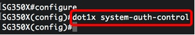

*Ảnh từ bài SMB5635 của Cisco: lệnh bật 802.1X toàn cục. Lưu ý: văn bản của bài viết có lỗi chính tả `dotx1`, ảnh cho thấy lệnh đúng là `dot1x system-auth-control`.*

**Bước 7: Kiểm tra và lưu:**

```
end
show dot1x
show dot1x users
show dot1x statistics
show radius-servers
copy running-config startup-config
```

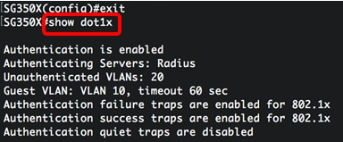

*Ảnh từ bài SMB5635 của Cisco: kết quả `show dot1x` (Authentication is enabled, Authenticating Servers: Radius, v.v.).*

### 10.5 Switch core và Wi-Fi

- **Switch core** (N4032, S4112F-ON, S4148F-ON): **không bật 802.1X**. Chỉ cần định tuyến để switch access gửi được RADIUS (UDP 1812/1813) tới ClearPass và ClearPass gửi được CoA (UDP 3799) về các switch hỗ trợ CoA.
- **Dell EMC S4112F-ON, S4148F-ON** thường chạy hệ điều hành khác (OS10) với cú pháp khác dòng N-Series. Nếu sau này cần 802.1X trên các máy này, phải tra tài liệu riêng.
- **Wi-Fi (WLC Cisco 9800-L):** tạo SSID **WPA2/WPA3-Enterprise** và trỏ RADIUS về ClearPass. Tài liệu này chưa viết cấu hình WLC. Trong ClearPass dùng service **802.1X Wireless**.

### 10.6 Miễn trừ trên switch và chu kỳ xác thực lại

**Cách A (miễn trừ theo MAC):** cổng cho phép máy vào bằng MAB. Cấu hình MAB nằm ở mục 10.3 (Dell: `dot1x mac-auth-bypass`, `authentication enable`, `authentication order dot1x mab`) và mục 10.4 (Cisco SG350: `dot1x authentication 802.1x mac`). Thiết bị phải có Endpoint với `Exempt = true` (mục 7.2.1) và service MAC Authentication (mục 8.6).

**Cách B (miễn trừ theo cổng):** cổng không xác thực gì cả. Dùng `force-authorized` trên **cổng cố định** của phòng kiểm soát (ví dụ phòng lab test).

Dell N-Series:

```
interface gi1/0/5
 dot1x port-control force-authorized
 exit
```

Cisco SG350:

```
interface gi1/0/5
 dot1x port-control force-authorized
 exit
```

Theo tài liệu cả hai hãng, `force-authorized` tắt 802.1X trên cổng và cổng chuyển sang trạng thái authorized mà không cần xác thực. **Bất kỳ thiết bị nào** cắm vào cổng này đều vào mạng. Hãy ghi lại cổng này trong danh sách ngoại lệ và rà soát định kỳ.

**Chu kỳ xác thực lại (phục vụ chính sách giờ, mục 8.4):**

Dell N-Series, trên cổng laptop (khoảng 300 đến 4294967295 giây, mặc định 3600):

```
interface gi1/0/10
 dot1x timeout re-authperiod 1800
 exit
```

Cisco SG350, trên cổng laptop (khoảng 300 đến 4294967295 giây, mặc định 3600, chỉ áp dụng cho 802.1X):

```
interface gi1/0/10
 dot1x timeout reauth-period 1800
 exit
```

Theo tài liệu Dell, nếu supplicant xác thực lại thất bại thì bị từ chối. Máy đang dùng lúc 21:00 sẽ bị cắt ở lần xác thực lại kế tiếp (tối đa khoảng 1800 giây sau). `dot1x reauthentication` phải bật trên cổng (đã có ở mục 10.3 bước 5 và mục 10.4 bước 4).

---

## 11. Giai đoạn 6a: Pilot ở chế độ giám sát

Mục tiêu: xem toàn bộ yêu cầu xác thực đi vào ClearPass mà **chưa chặn ai**.

1. Điều kiện: ClearPass Service đang **Monitor Mode** (mục 8.5), switch pilot đang ở chế độ giám sát (Dell: `dot1x system-auth-control monitor`; Cisco SG350: `authentication open` trên cổng pilot, mục 10).
2. Cắm **một laptop** có cấu hình GPO vào cổng pilot.
3. Mở **Monitoring → Live Monitoring → Access Tracker** trên ClearPass. Xem từng request, kết quả và danh sách Roles.
4. Kiểm tra từng laptop pilot:
   - Request có xuất hiện không. Nếu không: sai IP nguồn, sai secret, firewall (mục 14).
   - Roles có đủ `Domain-User` và `Allowed-Device` không.
5. Sửa whitelist và nhóm AD cho các máy thiếu. Lặp lại cho tới khi mọi laptop pilot nhận đủ hai role.

---

## 12. Giai đoạn 6b: Bật chặn thật (enforcement) và kiểm thử

### 12.1 Bật enforcement

Chỉ làm khi mục 11 không còn lỗi. Làm theo thứ tự:

1. **ClearPass:** vào Service `802.1X-Domain-MAC`, **bỏ tick Monitor Mode**, Save.
2. **Switch pilot:**
   - Dell: `no dot1x system-auth-control monitor` rồi `dot1x system-auth-control` (mục 10.3, bước 7).
   - Cisco SG350: `no authentication open` trên cổng pilot (mục 10.4, bước 5).
3. Lưu cấu hình trên switch.
4. Chạy toàn bộ kịch bản ở mục 12.2.

### 12.2 Kịch bản kiểm thử

Chạy trên **một switch/cổng pilot** sau khi đã bật enforcement (mục 12.1). Theo dõi tại **Monitoring → Live Monitoring → Access Tracker** (xem từng request, lý do chấp nhận hoặc từ chối).

| # | Kịch bản | Kết quả mong đợi | Kiểm tra |
|---|---|---|---|
| 1 | Laptop có MAC whitelist, đăng nhập tài khoản domain đúng | **Accept** | Access Tracker: Result Accept, Roles gồm `Domain-User` + `Allowed-Device` |
| 2 | Laptop **MAC không** whitelist, tài khoản domain đúng | **Reject** | Roles thiếu `Allowed-Device`, rơi vào Default |
| 3 | Laptop MAC whitelist, **sai mật khẩu** domain | **Reject** | Lỗi xác thực, không có `Domain-User` |
| 4 | Laptop MAC whitelist, tài khoản local (không phải domain) | **Reject** | Lỗi xác thực |
| 5 | Máy lạ MAC lạ, không có tài khoản | **Reject** | |
| 6 | Tài khoản domain bị khóa/hết hạn | **Reject** | |
| 7 | Thiết bị MAB (nếu có) | Theo policy MAB | |
| 8 | Đổi MAC sang `Disabled` hoặc xóa khỏi whitelist rồi cắm lại | **Reject** | |
| 9 | Laptop hợp lệ (domain đúng, MAC whitelist) xác thực **trong giờ bị chặn** (ví dụ 22:30 hoặc 02:00) | **Reject** | Access Tracker: rule 2 không khớp, rơi vào Default |
| 10 | Laptop hợp lệ xác thực **trong khung giờ** | **Accept** | Rule 2 khớp |
| 11 | Máy miễn trừ (`Exempt = true`) cắm vào trong giờ bị chặn (ví dụ 23:00) | **Accept** | Role `Exempt-Device`, rule 1 khớp |
| 12 | Laptop hợp lệ đang dùng lúc 20:50, quan sát sau 21:00 (đến 04:00) | Bị cắt ở lần xác thực lại kế tiếp | Chu kỳ `re-authperiod` / `reauth-period` (mục 10.6) |
| 13 | Máy lạ MAC không có trong danh sách miễn trừ cắm vào cổng MAB | **Reject** | Không có role `Exempt-Device` |


---

## 13. Giai đoạn 7: Nhân rộng và quay lui

### 13.1 Nhân rộng

Thêm từng switch hoặc từng tầng. Mỗi switch lặp lại: Network Device (mục 7.3) → cấu hình switch (mục 10) ở chế độ giám sát → kiểm tra → bật enforcement (mục 12.1).

### 13.2 Quay lui (rollback)

Khi cổng hoặc switch bị ảnh hưởng, làm theo thứ tự **nhẹ trước, mạnh sau**:

1. **ClearPass:** bật lại **Monitor Mode** trên Service (không cần chạm switch).
2. **Dell N-Series:** trên cổng bị ảnh hưởng: `dot1x port-control force-authorized` (tắt 802.1X trên cổng, cho phép truy cập). Toàn switch: `no dot1x system-auth-control`.
3. **Cisco SG350:** trên cổng: `dot1x port-control force-authorized` hoặc `no dot1x port-control` (về mặc định, cũng là `force-authorized`). Toàn switch: `no dot1x system-auth-control`.
4. Lưu cấu hình trên switch.

### 13.3 Sau triển khai

Đổi mật khẩu tài khoản join domain, cập nhật tài liệu, đào tạo helpdesk quy trình thêm MAC mới, lên lộ trình EAP-TLS.

---

## 14. Xử lý sự cố thường gặp

| Hiện tượng | Nguyên nhân thường gặp | Cách xử lý |
|---|---|---|
| Access Tracker không thấy request nào | Switch không tới được ClearPass, sai IP/secret, firewall chặn UDP 1812 | `ping`/kiểm tra route; kiểm tra secret; mở UDP 1812/1813 |
| Event Viewer báo **unknown NAS** | IP switch chưa khai báo hoặc khác IP nguồn RADIUS | Khai báo đúng IP trong Network Devices; đặt source-interface cho RADIUS (mục 10) |
| Join domain lỗi "Clock skew too great" | Giờ lệch trên 5 phút | Đồng bộ NTP |
| Join domain lỗi "Server not found in Kerberos database" | DNS sai | Trỏ DNS ClearPass về DNS của AD; dùng FQDN |
| Join domain lỗi **RPC timeout** | Firewall chặn cổng giữa ClearPass và DC | Mở các cổng mục 5.3 |
| Lỗi **0xc0000022** khi xác thực MSCHAPv2 | ClearPass chưa join domain hoặc join bị hỏng | Join lại domain (Leave rồi Join) |
| 802.1X lỗi nhưng MAC auth chạy được | `[Endpoints Repository]` đặt nhầm tab Authentication | Chuyển sang tab **Authorization** |
| Tài khoản đúng nhưng vẫn Reject | MAC chưa Known, định dạng MAC khác, MAC ngẫu nhiên | Kiểm tra định dạng `aabbccddeeff`; tắt Random MAC; xem Roles trong Access Tracker |
| Người dùng thuộc nhiều AD group, role gán sai | So khớp `memberOf` chỉ nhận một group | Dùng thuộc tính nested group, hoặc toán tử `MATCHES_ANY` |
| Policy Simulation thành công nhưng máy thật thất bại | Mô phỏng dùng PAP, máy thật dùng MSCHAPv2 | Luôn thử bằng máy thật |
| CoA không hoạt động | Chưa bật dyn-authorization, sai IP client, UDP 3799 bị chặn, chưa bật CoA trong Network Device | Kiểm tra từng điểm; log "Invalid client" cho biết IP không khớp |
| Laptop báo không tin cậy máy chủ | Chưa import Root CA vào laptop | Đẩy Root CA qua GPO |


---

## 15. Tóm tắt theo thứ tự

1. **Chuẩn bị:** thu thập thông tin (mục 3), kiểm tra giờ, DNS, cổng mạng (mục 5).
2. **Nền tảng ClearPass:** License, hostname/DNS/NTP, **join AD**, certificate RADIUS (mục 6).
3. **Danh tính và dữ liệu:** Authentication Source AD, whitelist MAC, Network Devices (mục 7).
4. **Chính sách:** Roles → Role Mapping → Enforcement Profile → Enforcement Policy (kèm **chính sách giờ** và **rule miễn trừ**) → Service 802.1X, rồi service MAB nếu có thiết bị miễn trừ. **Monitor Mode bật** (mục 8).
5. **Laptop:** GPO PEAP-MSCHAPv2, Wired AutoConfig, Root CA, tắt Random MAC (mục 9).
6. **Switch pilot:** RADIUS, AAA, bảo vệ uplink, cổng laptop, 802.1X ở chế độ giám sát (mục 10).
7. **Pilot:** xem Access Tracker, sửa whitelist (mục 11).
8. **Chặn thật:** tắt Monitor Mode, chạy kịch bản kiểm thử (mục 12).
9. **Nhân rộng**, có kế hoạch quay lui (mục 13).

---

## 16. Tài liệu tham khảo

> Ảnh trong các mục 6.3, 7, 8 lấy từ *ClearPass Policy Manager 6.14 Online Help* (PDF) và bài join AD 6.11. Ba ảnh ở mục 10.4 lấy từ bài SMB5635 của Cisco. Các ảnh thuộc bản quyền của nhà xuất bản và chỉ dùng làm tài liệu nội bộ. Cột "Hình ảnh" cho biết trang gốc có ảnh hay không. Mục "Trạng thái" cho biết đã đọc toàn bộ hay chỉ thấy trích đoạn.

| Nguồn | Nội dung dùng | Hình ảnh | Trạng thái |
|---|---|---|---|
| **ClearPass Policy Manager 6.14 Online Help** (PDF, `HPE_sd00007218en_us`) | Join AD, Authentication Source, Network Device, Endpoint, Role Mapping, Enforcement Policy, Service 802.1X Wired | Có | **Đã đọc** các mục liên quan |
| **Dell EMC Networking N-Series CLI Reference Guide** (bản 6.3.x, PDF, `dl.dell.com/manuals/common/networking_nxxcli_en-us.pdf`) | Lệnh RADIUS, `aaa authentication dot1x`, `dot1x port-control`, `dot1x system-auth-control [monitor]`, MAB, CoA, `show dot1x` | Không | **Đã đọc** các mục lệnh liên quan |
| **Cisco Business 350 Series CLI Guide**: [802.1X Commands](https://www.cisco.com/c/en/us/td/docs/switches/lan/csbms/CBS_250_350/CLI/cbs-350-cli-/802_1X_Commands.html) và [RADIUS Commands](https://www.cisco.com/c/en/us/td/docs/switches/lan/csbms/CBS_250_350/CLI/cbs-350-cli-/radius-commands.html) | Lệnh 802.1X và RADIUS cho dòng 350 | Không | **Đã đọc** các lệnh liên quan (dòng Cisco Business 350, không hoàn toàn trùng SG350) |
| [Cisco: Configure Global 802.1x Properties on a Switch through the CLI (SMB5635)](https://www.cisco.com/c/en/us/support/docs/smb/switches/cisco-small-business-300-series-managed-switches/smb5635-configure-global-802-1x-properties-on-a-switch-through-the-c.html) | Bật 802.1X toàn cục, `aaa authentication dot1x`, `show dot1x` | Có (3 ảnh dùng ở mục 10.4) | Đã đọc (văn bản có lỗi chính tả lệnh, đã đối chiếu với ảnh) |
| [HPE Aruba Technical Climb Webinar: ClearPass – Dot1x: Purpose of Domain Joining (PDF, 2016)](https://higherlogicdownload.s3.amazonaws.com/HPE/MigratedAssets/Airheads%20Webinar_Clearpass_Domainjoin.pdf) | Join AD, kiểm tra giờ (skew 5 phút), Password Servers, Leave AD Domain, lý do cần join cho PEAP-MSCHAPv2 | Có (ảnh chụp từng bước) | Đã đọc toàn văn (UI 2016, nhưng đường dẫn menu vẫn đúng với bản 6.x) |
| ClearPass Policy Manager 6.12 User Guide: [Configuring the Active Directory Authentication Source](https://support.hpe.com/hpesc/public/docDisplay?docId=sd00007001en_us&page=GUID-ED1E78F0-A6B5-4B39-88C4-477CA5CCF4CC.html&docLocale=en_US) | Tạo AD source, filter group `memberOf`, nested group `tokenGroups` | Có | Chỉ thấy trích đoạn qua tìm kiếm (trang tải về trống) |
| ClearPass 6.12 User Guide: [Preparing for Active Directory Authentication](https://support.hpe.com/hpesc/public/docDisplay?docId=sd00007001en_us&page=GUID-AD94E12E-DFF2-4188-A5C2-5CB05AEBF9A9.html&docLocale=en_US) | Yêu cầu join domain cho 802.1X, lệnh `ad auth` | Có | Chỉ thấy trích đoạn |
| ClearPass 6.12 User Guide: [RADIUS Server Options](https://support.hpe.com/hpesc/public/docDisplay?docId=sd00007001en_us&page=GUID-BAA744D7-2555-4FEB-8ED4-01D822E0BA8F.html&docLocale=en_US) | Tùy chọn tiến trình xác thực AD | Không rõ | Chỉ thấy trích đoạn |
| ClearPass 6.11/6.12 User Guide: [802.1X Wired service template](https://arubanetworking.hpe.com/techdocs/ClearPass/6.11/PolicyManager/Content/CPPM_UserGuide/Services/ServiceTypes8021XWired.htm) | Các tab Service/Authentication/Authorization/Roles/Enforcement; `Endpoints Repository` là nguồn Authorization | Có | **Không tải được (403)**, chỉ thấy trích đoạn |
| [HPE Validated Solution Guide: ClearPass client service configuration](https://arubanetworking.hpe.com/techdocs/VSG/docs/120-policy-deploy/esp-policy-deploy-040-clearpass-client-service-configuration/) | Cấu hình service 802.1X, role mapping, enforcement | Có | **Không tải được (403)**, chỉ thấy trích đoạn; nên mở trực tiếp để xem ảnh |
| Airheads: [ClearPass endpoints known/unknown/disabled](http://community.networking.hpe.com/discussion/clearpass-endpoints-known-unknown-disabled) | `Authorization:[Endpoints Repository]:Status`, đặt repository ở tab Authorization | Không | Đã đọc |
| Airheads: [ClearPass import MACs for MAC auth in bulk](http://community.networking.hpe.com/discussion/clearpass-import-macs-for-macauth-in-bulk) | Import CSV qua Guest → Manage Devices | Không | Đã đọc |
| Airheads: [ClearPass joining AD / lỗi join](https://airheads.hpe.com/discussion/clearpass-join-ad-domain) và [cổng ClearPass–AD](https://community.arubanetworks.com/discussion/what-are-the-right-ports-for-cppm-to-ad) | Xử lý sự cố join domain, cổng | Không | Chỉ thấy trích đoạn |
| Airheads: [AOS-CX 10.12 per-port RADIUS server group](https://airheads.hpe.com/discussion/aos-cx-1012-security-update-per-port-radius-server-group) và [CoA invalid client address](https://airheads.hpe.com/discussion/aruba-cx-coa-invalid-client-address) | Lệnh port-access, dyn-authorization trên AOS-CX | Không | Chỉ thấy trích đoạn |
| [Portnox: Aruba 802.1X switch configuration](https://doc.portnox.com/topics/nas_switches_aruba) | Cấu trúc lệnh RADIUS và port-access trên Aruba | Không | Đã đọc (trộn cú pháp AOS-Switch và AOS-CX, đã loại phần không dùng) |
| [Portnox: Cisco 802.1X switch configuration](https://doc.portnox.com/topics/nas_switches_cisco) | Cấu trúc lệnh Cisco IOS/IOS-XE | Không | Đã đọc |
| [Aruba Central: Configuring Authentication on AOS-CX](https://arubanetworking.hpe.com/techdocs/central/latest/content/nms/aos-cx/cfg/conf-cx-auth.htm) | Các dòng switch hỗ trợ port-access | Có | **Không tải được (403)**, chỉ thấy trích đoạn |
| [Microsoft Learn: EAP for network access in Windows](https://learn.microsoft.com/windows-server/networking/technologies/extensible-authentication-protocol/network-access) | Ý nghĩa các tùy chọn PEAP/MSCHAPv2, "Automatically use my Windows logon name and password" | Không | Đã đọc (một phần) |
| Microsoft: [Configure 802.1X Wired Access Clients for PEAP-MS-CHAP v2 Authentication](https://technet.microsoft.com/en-us/library/dd759154.aspx) | GPO Wired Network (IEEE 802.3) Policies | Có | Chỉ thấy trích đoạn (tài liệu Windows Server 2008 R2, giao diện hiện tại có thể khác) |
| Cisco: [Cisco ISE Secure Wired Access Prescriptive Deployment Guide](https://community.cisco.com/t5/security-documents/ise-secure-wired-access-prescriptive-deployment-guide/m-p/3641515) | Tham khảo cấu hình 802.1X trên Catalyst 9300 (dùng ISE, chỉ để so sánh cú pháp) | Có | Chỉ thấy trích đoạn |

### Việc cần làm để hoàn thiện tài liệu này

1. Chạy `show version` trên từng switch, đối chiếu CLI guide đúng model và firmware (đặc biệt **Dell N3224T-ON** và **Cisco SG350-52**).
2. Xác nhận **SG350 có hỗ trợ CoA hay không** và hành vi gửi MAC khi dùng `dot1x authentication 802.1X mac`.
3. Kiểm tra cách tham chiếu thuộc tính Endpoints Repository trong Role Mapping trên ClearPass thực tế.
4. Chạy thử toàn bộ trên **lab hoặc một switch pilot** trước khi triển khai thật.
---

## Phụ lục A. Ví dụ cho switch khác (chưa đối chiếu với tài liệu hãng)

Danh sách switch của dự án hiện chỉ có Dell và Cisco SG350 (mục 10). Phụ lục này giữ lại ví dụ cho Aruba AOS-CX và Cisco Catalyst để tham khảo nếu khách hàng có thêm các dòng đó. **Các ví dụ này chưa được đối chiếu với CLI guide, và cần kiểm tra theo model và firmware trước khi dùng.**

### A.1 Ví dụ Aruba AOS-CX (thay giá trị trong `<...>`)

> **⚠ Cần xác nhận** theo firmware (10.x). Một số bản có thêm tùy chọn như gán server-group theo từng cổng (từ 10.12). Nếu dùng Management VRF thêm `vrf mgmt` vào cuối các lệnh `radius-server host` và `radius dyn-authorization client`.

```
radius-server host <IP-ClearPass> key plaintext <SHARED-SECRET>
aaa group server radius CPPM
    server <IP-ClearPass>

aaa authentication port-access dot1x authenticator
    radius server-group CPPM
    enable

aaa accounting port-access start-stop interim group CPPM

radius dyn-authorization enable
radius dyn-authorization client <IP-ClearPass> secret-key plaintext <SHARED-SECRET>

interface 1/1/10
    aaa authentication port-access dot1x authenticator
        enable
```

Kiểm tra (tham khảo):

```
show aaa authentication port-access interface 1/1/10 client-status
show radius-server
```

Theo một thảo luận Airheads: nếu thấy log "Invalid client in disconnect request", nghĩa là CoA đến từ IP **chưa** được khai báo ở `radius dyn-authorization client`.


### A.2 Ví dụ Cisco IOS / IOS-XE (Catalyst)

Các lệnh dựa trên mẫu cấu hình trong tài liệu Portnox và hướng dẫn IEEE 802.1X của Cisco. **Không trả lời "Yes" khi lệnh `aaa accounting identity` hỏi chuyển sang CPL** (theo cảnh báo trong tài liệu này, đồng ý có thể không hoàn tác được).

```
aaa new-model
radius server CPPM
 address ipv4 <IP-ClearPass> auth-port 1812 acct-port 1813
 key <SHARED-SECRET>
aaa group server radius CPPM-GRP
 server name CPPM
aaa authentication dot1x default group CPPM-GRP
aaa authorization network default group CPPM-GRP
aaa accounting dot1x default start-stop group CPPM-GRP
dot1x system-auth-control

aaa server radius dynamic-author
 client <IP-ClearPass> server-key <SHARED-SECRET>

ip radius source-interface <Vlan-quan-tri>

interface GigabitEthernet1/0/10
 switchport mode access
 authentication port-control auto
 dot1x pae authenticator
 authentication host-mode multi-auth
```

Kiểm tra:

```
show dot1x all
show authentication sessions interface GigabitEthernet1/0/10
```

> **⚠ Cần xác nhận:** các bản IOS-XE mới dùng chính sách `access-session`/IBNS 2.0 thay cho lệnh `authentication ...` trên cổng. Đối chiếu configuration guide của đúng model và phiên bản.


### A.3 Wi-Fi

Cấu hình ở WLC/AP: tạo SSID **WPA2/WPA3-Enterprise**, trỏ RADIUS về ClearPass (IP, secret, cổng 1812/1813), khai báo WLC/AP trong ClearPass Network Devices và dùng service **802.1X Wireless**.
