# Hướng dẫn tích hợp Active Directory (join domain) vào ClearPass Policy Manager

> **Nguồn:** *Joining a Policy Manager Server to an Active Directory Domain*, **ClearPass Policy Manager 6.14 Online Help** (HPE, file PDF `HPE_sd00007218en_us`). Đã đối chiếu với bản 6.11: nội dung phần join AD giống nhau.
> **Áp dụng:** ClearPass 6.14 (các bản 6.11 đến 6.12 tương tự).
> **Phạm vi:** join/leave domain, chọn domain controller cho xác thực MSCHAPv2. Phần tạo Authentication Source, Service 802.1X và whitelist MAC xem [Huong-dan-ClearPass-802.1X-Domain-va-MAC-hop-le.md](Huong-dan-ClearPass-802.1X-Domain-va-MAC-hop-le.md).

> **Ảnh minh họa:** 11 ảnh chụp màn hình lấy từ bài gốc, lưu trong [images/ad-join/](images/ad-join/). Tên trường và nút bấm trong tài liệu này đã được đối chiếu với các ảnh đó.
> **Bảng tham số:** lấy từ file PDF 6.14 (phần Date & Time, Join AD Domain, ký tự cho phép, Leave AD Domain). Ảnh minh họa lấy từ bài 6.11, giao diện các hộp thoại này giữ nguyên.

---

## 1. Vì sao ClearPass phải join AD?

- Với **EAP-PEAP-MSCHAPv2** (802.1X), ClearPass chỉ dùng **password hash** do người dùng gửi lên để xác thực với AD, thông qua **NTLM**.
- NTLM bắt buộc máy xác thực (ClearPass) phải là **thành viên của domain**. Khi join, ClearPass tạo một **computer account** cho node đó trong AD.
- Sau khi join, người dùng vào mạng bằng 802.1X với chính tài khoản AD của họ.
- ClearPass tự thương lượng phiên bản **SMB** cao nhất mà cả hai bên hỗ trợ (SMBv1, v2, v3).
- Khi xác thực NTLM, ClearPass hỏi AD để chọn domain controller phù hợp.

### Cần join bao nhiêu domain?

| Tình huống | Cách làm |
|---|---|
| Một domain | Join domain đó |
| Nhiều domain **cùng một forest** | Chỉ join **root domain** (giữa các domain trong forest có trust) |
| Nhiều forest/domain **không có trust** với nhau | Join **từng forest/domain** riêng |

### Authentication Source khác với join domain

Với dịch vụ 802.1X dùng PEAP-MSCHAPv2, **việc xác thực** (kiểm tra mật khẩu) do cơ chế join domain ở trên đảm nhiệm. **Authentication Source** loại Active Directory trong Policy Manager trong trường hợp này chỉ dùng cho **phân quyền** (đọc group, thuộc tính user). Hai thứ này được cấu hình riêng.

---

## 2. Điều kiện tiên quyết

1. **Tài khoản join domain:** một tài khoản AD có quyền thêm computer vào domain (Domain Admin hoặc tài khoản được ủy quyền). Nếu không chắc, hỏi quản trị viên Windows. Thao tác join chỉ làm **một lần**.
2. **Thời gian:** lệch giờ giữa ClearPass và domain controller **tối đa 5 phút**. Vượt quá thì join/xác thực Kerberos sẽ lỗi.
3. **DNS:** ClearPass phải phân giải được tên domain controller. **DNS primary của ClearPass nên là IP của domain controller** (thường DC cũng là DNS server).
4. **Kết nối mạng** từ ClearPass tới DC (DNS, Kerberos, LDAP, SMB...). Mở đủ cổng theo chính sách firewall của khách hàng.
5. Node ClearPass chưa từng join domain này (nếu đã từng join, xem mục 7 để leave trước).

---

## 3. Đồng bộ thời gian (NTP) và múi giờ

> Thực hiện trên **Publisher**. Subscriber tự đồng bộ giờ từ Publisher.

### 3.1 Cấu hình ngày giờ / NTP

1. Đăng nhập **Publisher**.
2. Vào **Administration > Server Manager > Server Configuration**.
3. Chọn liên kết **Set Date and Time**. Hộp thoại **Change Date and Time** mở ở tab **Date & Time**.
4. Tick **Synchronize time with NTP server** (mặc định đã bật) và điền thông số. Nếu bỏ tick, bạn nhập ngày giờ của cluster bằng tay:

   | Trường | Ý nghĩa |
   |---|---|
   | **NTP Server** | IP (IPv4 hoặc IPv6) hoặc hostname của NTP server **Primary** và **Secondary**. ClearPass có thể đồng bộ với bất kỳ NTP server nào đã cấu hình, theo thứ tự bất kỳ, không ưu tiên Primary trước. |
   | **Key ID** | Số từ 1 đến 65534, chỉ số của key. Chỉ cần khi NTP server yêu cầu xác thực. Client và server phải tin cùng cặp Key ID và Key Value. |
   | **Key Value** | Khóa dùng chung (shared secret). Là chuỗi ASCII in được tối đa 20 ký tự, hoặc giá trị hex tối đa 40 ký tự. Chuỗi ASCII không được chứa `& ; \` | < > ( )` và phải bắt đầu, kết thúc bằng một trong các ký tự `-` `'` `"`. |
   | **Algorithm** | `SHA` hoặc `SHA1`. Ở chế độ FIPS chỉ dùng `SHA1`. |

   Nếu NTP server không yêu cầu xác thực, để trống Key ID, Key Value và Algorithm.
5. Bấm **Save**, sau đó **Cancel** để quay lại trang Server Configuration.
6. So sánh đồng hồ hiển thị ở cuối trang Server Configuration với đồng hồ trên AD server. Chênh lệch phải **≤ 5 phút**.

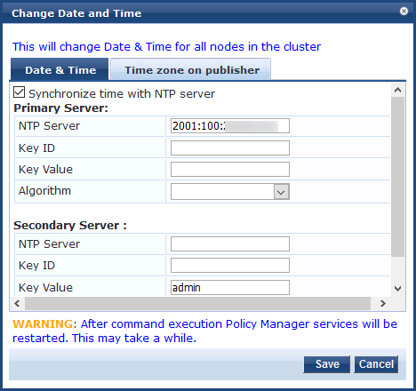

*Hình 1. Hộp thoại Change Date and Time: tick Synchronize time with NTP server, nhập NTP Server (ảnh ví dụ dùng địa chỉ IPv6, IPv4 hoặc FQDN đều được).*

Ảnh cho thấy dòng cảnh báo: **sau khi lưu, các dịch vụ Policy Manager sẽ khởi động lại và có thể mất một lúc**. Hộp thoại áp dụng cho **toàn bộ node trong cluster**.

### 3.2 Khởi động lại dịch vụ

Sau khi lưu cấu hình ngày giờ phải kiểm tra/khởi động lại các dịch vụ:

1. Vào **Administration > Server Manager > Server Configuration**, chọn node **Publisher**.
2. Mở tab **Services Control**.
3. Ở cột **Action**, bấm **Start** cho từng dịch vụ đang dừng. Nút đổi thành **Stop** là dịch vụ đã chạy.

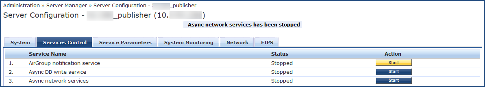

*Hình 2. Tab Services Control: dịch vụ nào có Status là Stopped thì bấm Start ở cột Action. Ảnh có thông báo "Async network services has been stopped".*

> Thay đổi cấu hình NTP được ghi lại trong **Monitoring > Audit Viewer**.

### 3.3 Chọn múi giờ

1. Mở tab **Time Zone on Publisher**.
2. Chọn múi giờ nơi đặt Publisher (danh sách xếp theo thứ tự chữ cái, ví dụ `Asia/Ho_Chi_Minh`), bấm **Save**. Dòng **Current time zone** ở dưới cùng cho biết múi giờ hiện tại (ảnh ví dụ là `Asia/Kolkata (GMT +5:30)`).

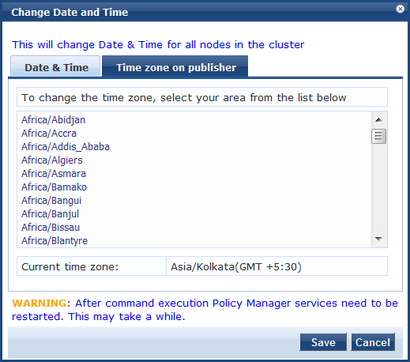

*Hình 3. Tab Time zone on publisher. Cũng có cảnh báo dịch vụ cần khởi động lại sau khi lưu.*

3. Với **Subscriber**, múi giờ đặt riêng trong trang cấu hình của từng server.

---

## 4. Join ClearPass vào domain AD

1. Vào **Administration > Server Manager > Server Configuration**.
2. Bấm vào **tên server** cần join. Trang cấu hình của server mở ở tab **System**. Ở cuối trang, mục **AD Domains** đang báo *"Policy Manager is not part of any domain. Join to domain here."*
3. Bấm **Join AD Domain**.

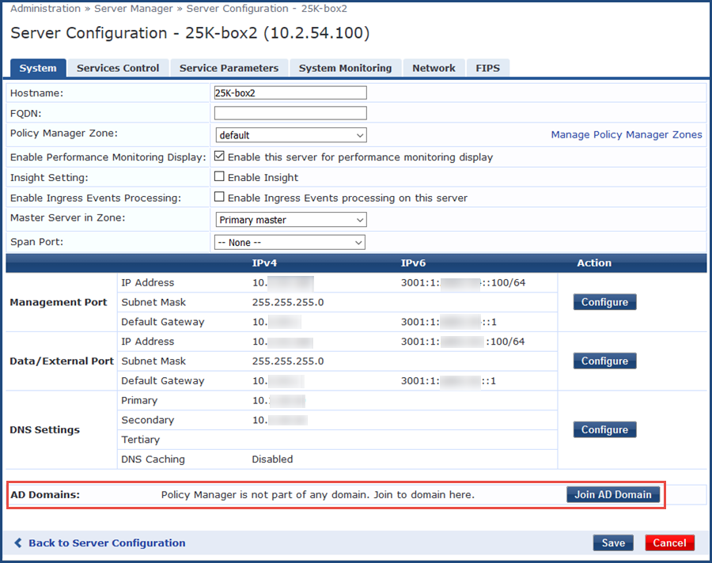

*Hình 4. Tab System của server chưa join domain. Khung đỏ là mục AD Domains với nút Join AD Domain. Lưu ý mục **DNS Settings** phía trên: DNS Primary phải là IP của domain controller.*

4. Hộp thoại **Join AD Domain** mở ra.

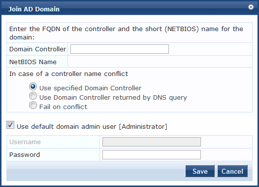

*Hình 5. Hộp thoại Join AD Domain.*

5. Điền thông số:
   - **Domain Controller:** nhập FQDN của domain controller, ví dụ `dc1.arubasecurity.net`, rồi **nhấn Tab**. ClearPass hiện thông báo *Trying to determine the NetBIOS name...* và tự tìm NetBIOS name. Nếu DC không phải DC gần nhất, ClearPass hiện cảnh báo. **Luôn join vào DC gần nhất về mặt vật lý**, nếu không xác thực có thể lỗi hoặc chậm.
   - **NetBIOS Name:** tự điền, không sửa được. Nếu giá trị sai, giao diện báo cảnh báo. Khi đó bấm **Leave Domain** (nút này thay cho Join Domain sau khi đã join), rồi join lại với NetBIOS name đúng.
   - **In case of a controller name conflict:** hành động khi FQDN DNS trả về khác FQDN bạn nhập. Tình huống này hay gặp khi có nhiều DC hoặc nhập sai tên domain. Chọn một trong ba:
     - **Use specified Domain Controller** (mặc định): tiếp tục dùng DC bạn đã nhập.
     - **Use Domain Controller returned by DNS query**: dùng DC mà DNS trả về.
     - **Fail on conflict**: hủy thao tác join.
   - **Use default domain admin user [Administrator]:** tick thì ClearPass dùng tài khoản `Administrator` và khóa ô Username. Trên môi trường thật, thường dùng tài khoản quản trị riêng có quyền join máy vào domain: bỏ tick rồi nhập **Username** và **Password**.
   - **Password:** mật khẩu của tài khoản join.

   Ký tự cho phép:

   | Trường | Ký tự cho phép |
   |---|---|
   | Username | `~ ! @ # $ % ^ * _ - + = { } , . \ ' " ? /` |
   | Password | `! @ # $ % ^ & * ( ) _ - + = { } < , > . ? /` |

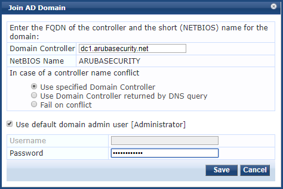

*Hình 6. Đã nhập Domain Controller `dc1.arubasecurity.net`, NetBIOS Name tự hiện `ARUBASECURITY`, giữ tùy chọn mặc định và nhập Password.*

6. Bấm **Save**. Màn hình trạng thái hiển thị tiến trình:
   - `Checking whether <name> domain controller is co-located with this ClearPass Policy Manager server.`
   - `Adding host to AD domain`
   - Khi thành công: **`Added host to the domain`**.
7. Dịch vụ tự khởi động lại. Dòng **INFO** cuối cùng báo server đã join domain.

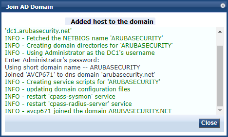

*Hình 7. Log join thành công. Các bước chính theo log: lấy NetBIOS name, tạo thư mục domain, dùng Administrator làm username, join computer `AVCP671` vào DNS domain `arubasecurity.net`, tạo service script, cập nhật file cấu hình domain, khởi động lại hai service `cpass-sysmon` và `cpass-radius-server`, và dòng cuối `avcp671 joined the domain ARUBASECURITY.NET`.*

8. Bấm **Close**. Trang Server Configuration giờ cho thấy server đã join domain.

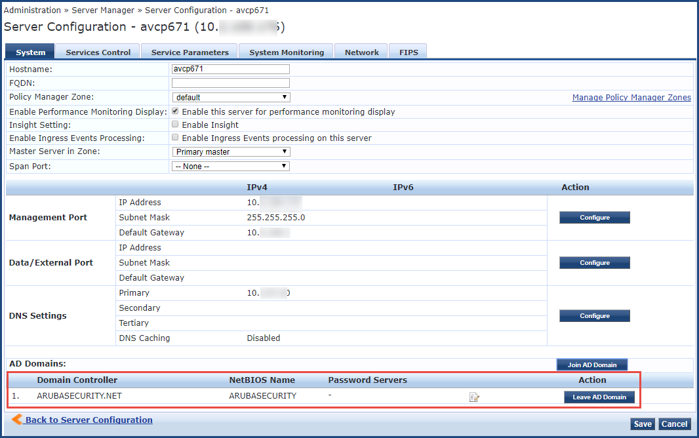

*Hình 8. Mục AD Domains giờ liệt kê **Domain Controller** `ARUBASECURITY.NET`, **NetBIOS Name** `ARUBASECURITY`, cột **Password Servers** (đang là `-`, tức chưa giới hạn DC) và nút **Leave AD Domain**. Nút **Join AD Domain** vẫn còn để join thêm domain khác.*

### Cảnh báo có thể gặp

| Thông báo | Ý nghĩa và cách xử lý |
|---|---|
| `Unable to identify which Active Directory site this Policy Manager server is located in. Authentications might fail or be impacted if the selected domain controller is not co-located.` | AD chưa khai báo thông tin **site**. ClearPass không biết DC nào gần nhất. Khai báo site/subnet trong AD, hoặc chấp nhận nếu chỉ có một site. |
| Cảnh báo cùng nút **Find Domain Controller** | ClearPass nhận thấy DC đã chọn **không phải DC gần nhất**. Bấm **Find Domain Controller** để xem danh sách, chọn DC phù hợp hoặc tiếp tục với DC ban đầu. |

---

## 5. (Tùy chọn) Chỉ định domain controller cho xác thực MSCHAPv2

- Mặc định, nếu không chỉ định, ClearPass dùng **tất cả domain controller lấy được từ DNS**.
- Nếu muốn giới hạn (ví dụ chỉ dùng các DC cùng site):

1. Vào **Administration > Server Manager > Server Configuration**.
2. Chọn tên server ClearPass. Trang mở ở tab **System**.
3. Trong mục **AD Domains**, bấm biểu tượng **Modify Password Servers** (biểu tượng nhỏ ở cạnh cột Password Servers, cùng hàng với domain).

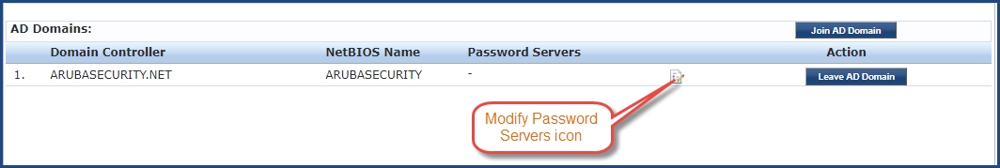

*Hình 9. Biểu tượng Modify Password Servers nằm giữa cột Password Servers và nút Leave AD Domain.*

4. Hộp thoại **Configure AD Password Servers** mở ra. Nhập **hostname hoặc IP** của các DC vào ô **Password Servers**, **mỗi dòng một DC**. Hộp thoại hiển thị sẵn **Domain Controller** và **NetBIOS Name** của domain (chỉ đọc).

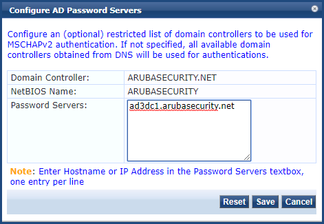

*Hình 10. Ví dụ nhập `ad3dc1.arubasecurity.net`. Nút **Reset** xóa danh sách để quay về mặc định (dùng tất cả DC lấy từ DNS).*

5. Bấm **Save**.

> Chỉ cấu hình được password server **sau khi** đã join domain thành công.

---

## 6. Kiểm tra sau khi join

1. Trang **Server Configuration > System** liệt kê domain trong mục **AD Domains** (xem Hình 8).
2. Trong AD (Active Directory Users and Computers), computer account của ClearPass xuất hiện trong container **Computers** (thường là mặc định). Vị trí thực tế phụ thuộc cấu hình AD của khách hàng. Tài liệu HPE chỉ nói ClearPass tạo một account cho node trong cơ sở dữ liệu AD.
3. Bước tiếp theo: tạo **Authentication Source** loại Active Directory và Service 802.1X (xem hướng dẫn 802.1X trong repo).

---

## 7. Rời domain (Leave AD Domain)

ClearPass dùng thông tin đăng nhập bạn cung cấp để **xóa computer account khỏi AD** trước, rồi mới xóa quan hệ domain phía ClearPass. Dùng khi chuyển domain, hoặc node đã join nhiều domain và cần gỡ một domain.

1. Vào **Administration > Server Manager > Server Configuration**.
2. Chọn server cần gỡ.
3. Bấm **Leave AD Domain**. Hộp thoại **Leave AD Domain** mở ra.
4. Hộp thoại hiển thị **Domain Controller** (chỉ đọc). Chọn các tùy chọn:
   - **Leave domain even if AD is Down:** ClearPass vẫn cố xóa computer account khỏi AD, nhưng nếu AD không truy cập được thì **không dừng lại**, mà gỡ liên kết phía ClearPass. Khi đó quản trị viên AD phải **xóa tay computer account** của ClearPass.
   - **Use default domain admin user [Administrator]:** dùng `Administrator` hoặc tài khoản AD có quyền tương đương. Tài khoản này không nhất thiết là tài khoản đã dùng để join, chỉ cần có quyền thực hiện thao tác này.
   - **Password:** mật khẩu của tài khoản đó.

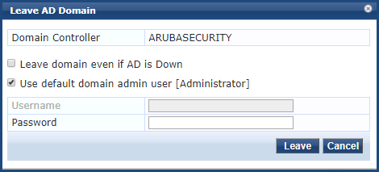

*Hình 11. Hộp thoại Leave AD Domain.*

5. Bấm **Leave**. Màn hình trạng thái hiển thị `Removing host from the AD domain`, khi xong là `Removed host from the domain`.
6. Bấm **Close**. Ở trang **Server Configuration > System**, server không còn nằm trong mục **AD Domains**.
7. Bấm **Save**.

---

## 8. Xử lý sự cố nhanh

| Triệu chứng | Kiểm tra |
|---|---|
| Join thất bại, lỗi liên quan Kerberos hoặc thời gian | Lệch giờ > 5 phút. Kiểm tra lại NTP và múi giờ (mục 3). |
| Không tìm thấy domain controller | DNS của ClearPass chưa trỏ về DC. Kiểm tra DNS primary và phân giải FQDN của DC. |
| Lỗi quyền | Tài khoản không có quyền join computer vào domain. Dùng tài khoản khác hoặc nhờ quản trị viên Windows ủy quyền. |
| Join được nhưng xác thực chậm hoặc lỗi | DC được chọn không co-located. Dùng **Find Domain Controller** hoặc giới hạn **Password Servers** (mục 5). |
| Người dùng ở domain khác (không trust) không đăng nhập được | Cần join thêm ClearPass vào domain/forest đó (mục 1). |
| Join lại báo đã tồn tại | Computer account cũ còn trong AD. Leave domain đúng cách hoặc xóa computer account cũ trong AD. |
| Đã join nhiều domain, cần gỡ một domain | Mỗi domain đã join là một dòng trong mục **AD Domains** (Hình 8). Bấm **Leave AD Domain** ở đúng dòng cần gỡ. |

---

## 9. Tài liệu tham khảo

- HPE, *ClearPass Policy Manager 6.14 Online Help* (PDF, mục *Joining a Policy Manager Server to an Active Directory Domain*).
- HPE, *Joining a Policy Manager Server to an Active Directory Domain*, ClearPass Policy Manager 6.11 Online Help (nguồn của các ảnh): https://support.hpe.com/hpesc/public/docDisplay?docId=sd00007000en_us&page=GUID-F825CB42-8E6F-4BC7-9A25-8CC4912804C8.html
